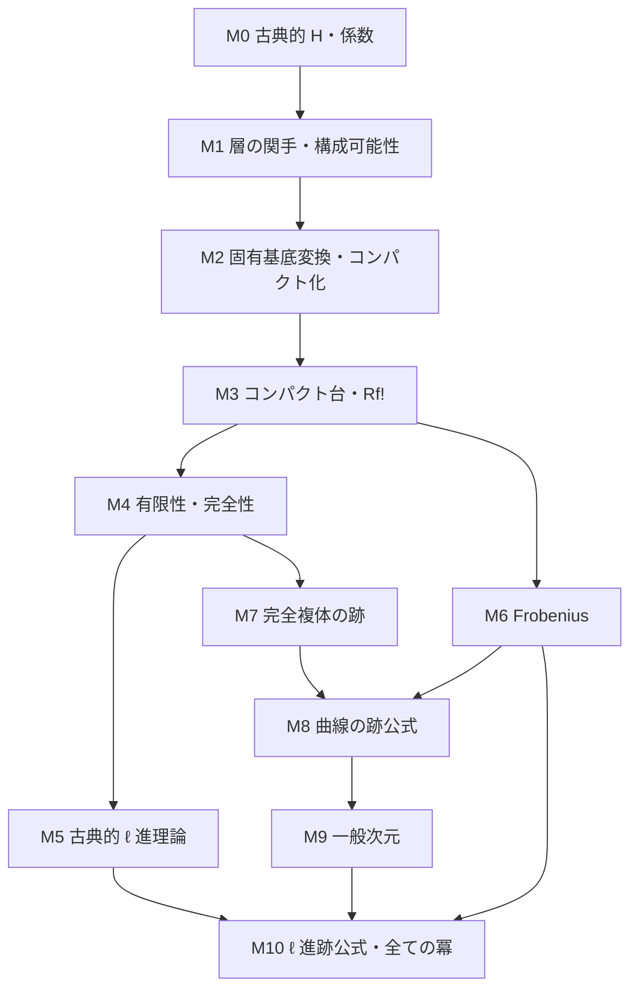

# Grothendieck–Lefschetz 跡公式の形式化計画

作成日: 2026-10-04

配置先: `Lean4/EtaleCohomology`

作業状態: **2026-10-05 に M1 の残りを実装・検証し、M1 を完了した。次の未完了段階は M2 の固有基底変換・コンパクト化である。**

状態: **M0・M1 完了。層の関手・随伴・茎・必要な完全性、閉直像と古典的コホモロジーの比較、局所化長完全列、有限 étale 表現可能性・有限自明化・モノドロミーとの比較を検証済み。構成可能性の Zariski 局所性、qcqs 基底での大域有限層別化、任意の射による引き戻し、核・余核・拡大、必要な像の条件下での開零拡張・閉直像・開閉分解に沿う局所閉拡張の保存まで完成した。M2 以降と跡公式本体は未完成。**

小 étale site の実際の層と mathlib の `Sheaf.H` を使っている。構成可能性は実際の局所閉部分スキーム上の有限型局所定数性で定義し、有限層別化・射の局所加群表示・拡大の余核表示を具体的に構成する。核と拡大には係数環の Noether 性を仮定し、余核・引き戻し・局所性・開閉操作には任意の可換係数環を許す。開零拡張には開埋め込みの準コンパクト性、閉直像には像の補集合の retrocompact 性を明示し、基底スキームの Noether 性や有限体上という仮定で代用しない。

## 1. 完成させる定理

有限体の Frobenius 版を主目標とする。対象を曲線・滑らかなスキーム・固有スキームに限定しない。

- \(k=\mathbf F_q\) は有限体、\(p=\operatorname{char}k\)。
- \(X\to\operatorname{Spec}k\) は分離有限型スキーム。
- \(\ell\) は \(p\) と異なる素数。
- \(\mathcal F\) は **\(X\) 上で定義された**構成可能な \(\mathbf Q_\ell\)-進 étale 層。
- \(m\geq1\)、\(k_m/k\) は次数 \(m\) の有限拡大。
- \(X_{\bar k}=X\times_k\bar k\)。以下の係数も必要に応じて幾何的基底変換する。

証明する等式は

\[
\sum_{x\in X(k_m)}
 \operatorname{Tr}\!\left(
   \operatorname{Frob}^{\mathrm{geom}}_{x,k_m}
   \mid\mathcal F_{\bar x}\right)
=
\sum_{i=0}^{2d}(-1)^i
 \operatorname{Tr}\!\left(
   (\operatorname{Frob}^{\mathrm{geom}}_q)^m
   \mid H_c^i(X_{\bar k},\mathcal F)\right),
\qquad d=\dim X .
\]

空スキームは別途ゼロの場合を処理する。実装では次元の表現に合わせ、まず任意の自然数上界 \(d\geq\dim X\) を用いて有限和を作り、上界からの独立性を証明して上の表示を得る。
両辺は \(\mathbf Q_\ell\) の元である。左辺の有限性、右辺の有限次元性と次数による消滅も本ライブラリから供給する。
幾何的点の選択による局所作用の共役と、跡の選択からの独立性を証明する。

定数層の場合には、次の点数公式を公開する。

\[
\#X(k_m)=
\sum_{i=0}^{2d}(-1)^i
\operatorname{Tr}\!\left(
  (\operatorname{Frob}^{\mathrm{geom}}_q)^m
  \mid H_c^i(X_{\bar k},\mathbf Q_\ell)\right).
\]

有限係数の証明では有界構成可能複体と有限 Tor 次元を扱う。最終的には有界構成可能な \(\mathbf Q_\ell\)-進複体にも、茎の交代跡を左辺に置く形で拡張する。複体のコホモロジー層が \([a,b]\) にある場合の和の範囲は \([a,b+2d]\) とする。

一般の自己写像に対する局所 Lefschetz–Verdier 公式、重み理論、Weil 予想の絶対値評価はこの完成条件に含めない。今回の跡公式の証明に使う étale cohomology の基礎定理は含める。
定理の数学的対象の参考は [SGA 4½](https://publications.ias.edu/book/export/html/378) と [Milne, Lectures on Étale Cohomology, §§25, 29](https://www.jmilne.org/math/CourseNotes/LEC.pdf)。

## 2. 調査した環境と利用可能な基盤

初期調査は下記の固定リビジョンに対するソース確認。以後の新規 Lean 宣言の検証結果は第6節に記録する。

| 項目 | 確認値 |
|---|---|
| Git / Lake root | `/home/nyama/work` |
| 調査開始時の workspace commit | `2cef3f95b856a7a32a21656adbe14902960ca537` |
| Lean | `leanprover/lean4:v4.35.0-rc2` |
| mathlib | `065356127b1dc0016f66b7283ce0ce2c4055aa55` |
| `Lean4/EtaleCohomology` | 計画作成前は空 |
| Lake 登録・集約 | 初期調査時は未作成。M0 実装時に `EtaleCohomology.All` と再帰的集約を登録済み |

### 2.1 実在を確認した API

下のパスは mathlib root を基準とする。`Sites/` は `Mathlib/AlgebraicGeometry/Sites/`、`SheafCohomology/` は `Mathlib/CategoryTheory/Sites/SheafCohomology/` の省略である。実装時にも対象宣言の型・universe・instance の供給元を確認する。

| 用途 | ファイルと主要宣言 | 利用方法 |
|---|---|---|
| 小 étale site | `Mathlib/AlgebraicGeometry/Sites/Etale.lean`: `Scheme.smallEtaleTopology` | `X.Etale` とその既存 topology を使う |
| affine site との比較 | `Sites/AffineEtale.lean`: `Scheme.AffineEtale.sheafEquiv` | 小ささ・層圏の性質の供給 |
| 層圏の Grothendieck 性 | 同上: `isGrothendieckAbelian_sheaf_smallEtaleTopology` | `Sheaf X.smallEtaleTopology (ModuleCat R)` に既存 instance がある |
| 幾何的点 | `Sites/EtalePoint.lean`: `pointSmallEtale`、`isConservativeFamilyOfPoints_pointSmallEtale'` | enough points と茎による同型判定を利用 |
| 古典的層コホモロジー | `Mathlib/CategoryTheory/Sites/SheafCohomology/Basic.lean`: `Sheaf.H`、`Sheaf.H.equiv₀`、`Sheaf.H.map` | `Ext` による既存の定義そのものを出発点にする |
| 長完全列 | `SheafCohomology/ExactSequences.lean`: `Sheaf.H.δ`、`longSequence_exact` とその自然性 | 層の短完全列から利用 |
| Mayer–Vietoris | `SheafCohomology/MayerVietoris.lean` | 一般 site 上の既存結果。コンパクト台付き局所化とは別に接続が必要 |
| Ext と単射分解 | `Mathlib/CategoryTheory/Abelian/GrothendieckCategory/HasExt.lean` ほか | 小 étale 層圏の Grothendieck 性から供給 |
| 右導来関手 | `Mathlib/Algebra/Homology/DerivedCategory/RightDerivedFunctorPlus.lean`: `Functor.rightDerivedFunctorPlus` | 実際に構成した \(\Gamma,f_*\) に適用 |
| 加群・環の層 | `Mathlib/Algebra/Category/ModuleCat/Sheaf.lean` ほか | 必要なら既存の `SheafOfModules` を利用。定数係数には通常の `Sheaf ... (ModuleCat R)` を優先 |
| 線形代数の跡 | `Mathlib/LinearAlgebra/Trace.lean`: `LinearMap.trace` | 有限次元 \(\mathbf Q_\ell\)-空間の跡。有限次元性を証明して使う |

固定版の出典:
[étale site](https://github.com/leanprover-community/mathlib4/blob/065356127b1dc0016f66b7283ce0ce2c4055aa55/Mathlib/AlgebraicGeometry/Sites/Etale.lean)、
[affine étale site](https://github.com/leanprover-community/mathlib4/blob/065356127b1dc0016f66b7283ce0ce2c4055aa55/Mathlib/AlgebraicGeometry/Sites/AffineEtale.lean)、
[幾何的点](https://github.com/leanprover-community/mathlib4/blob/065356127b1dc0016f66b7283ce0ce2c4055aa55/Mathlib/AlgebraicGeometry/Sites/EtalePoint.lean)、
[古典的コホモロジー](https://github.com/leanprover-community/mathlib4/blob/065356127b1dc0016f66b7283ce0ce2c4055aa55/Mathlib/CategoryTheory/Sites/SheafCohomology/Basic.lean)、
[長完全列](https://github.com/leanprover-community/mathlib4/blob/065356127b1dc0016f66b7283ce0ce2c4055aa55/Mathlib/CategoryTheory/Sites/SheafCohomology/ExactSequences.lean)、
[右導来関手](https://github.com/leanprover-community/mathlib4/blob/065356127b1dc0016f66b7283ce0ce2c4055aa55/Mathlib/Algebra/Homology/DerivedCategory/RightDerivedFunctorPlus.lean)、
[跡](https://github.com/leanprover-community/mathlib4/blob/065356127b1dc0016f66b7283ce0ce2c4055aa55/Mathlib/LinearAlgebra/Trace.lean)。

### 2.2 既存の `EllAdicCohomology` との関係

mathlib の `Scheme.ellAdicSheaf` は pro-étale site 上の \(\mathbf Z_\ell\) 値連続関数の層であり、`Scheme.EllAdicCohomology` はそのコホモロジーである。
同ファイルには古典的 étale cohomology による定義との比較を今後行う旨が記されており、その比較定理は当該ファイルにはない。
したがって今回は、**有限係数の小 étale site → 古典的 adic system → \(\mathbf Z_\ell,\mathbf Q_\ell\) 係数**を主経路とする。
既存の pro-étale 定義を別名で包んで古典的構成の代用にはしない。
[固定版の実装と注記](https://github.com/leanprover-community/mathlib4/blob/065356127b1dc0016f66b7283ce0ce2c4055aa55/Mathlib/AlgebraicGeometry/Sites/ElladicCohomology.lean)。

pro-étale との比較は、必要な仮定を精査した上での別の後続課題とする。今回の跡公式はこの比較を仮定しない。

関連する公開プロジェクト [Christian Merten, `proetale`](https://github.com/chrisflav/proetale) は、Bhatt–Scholze の Theorem 5.6.2 に基づく古典的 ℓ 進コホモロジーとの比較を長期目標としている。2026-10-04 に確認した README・blueprint と関連検索の範囲では、M2 の固有基底変換・Nagata コンパクト化の完成済み実装は確認できていない。局所構造や site の基礎の再利用候補とし、M2 の供給元が確定したとは扱わない。

### 2.3 供給元をまだ確認できていない主要部分

`Mathlib/AlgebraicGeometry` と `Mathlib/CategoryTheory/Sites` の関連パス・宣言名を絞った調査では、次の完成済み API は見つかっていない。

- étale 層の extension by zero \(j_!\)、構成可能性・lisse 性の必要な一式。
- 固有基底変換、コンパクト化に基づく \(Rf_!\)、コンパクト台付きコホモロジー。
- この用途の Nagata コンパクト化、有限性・コホモロジー次元の定理。
- スキームの Frobenius とその étale cohomology への作用・比較。
- 古典的 adic system の導来逆極限、有限係数との比較。
- 完全複体の跡と、曲線の証明に使う群環係数の跡。

これは限定した範囲の調査結果であり、別名で存在する全補題の不存在を主張するものではない。各段階の着手時には対応する最小の依存先を確認し、既存の供給元があれば再利用する。
局所ライブラリの有限 étale 被覆や基本群の結果は有限局所定数層の段階で候補になるが、それだけで小 étale topos 全体の導来コホモロジーが得られるとは扱わない。
`FiniteField` という既存フォルダ名だけから、有限体の Frobenius 理論が完成しているとも判断しない。

## 3. 定義をどのように作るか

### 3.1 有限係数と古典的コホモロジー

**一般性の方針（2026-10-04 の依頼を反映）:** 基礎の定義・補題は証明に必要な最小限の仮定で作る。一般のサイト・係数圏で成立する議論はその範囲で実装し、スキームに固有の結果も任意のスキーム・係数環を出発点とする。現行の古典的コホモロジーと長完全列、層の関手・幾何的な茎の理論には有限体を仮定していない。

コンパクト台付き・\(\ell\) 進理論の定義にも有限体の仮定を組み込まない。分離性・有限型性・基礎の noetherian 条件・係数の torsion 性・\(\ell\) の可逆性などは、それぞれが必要な存在・比較・有限性・消滅定理で明示する。定義の一般性と、有限性定理の成立範囲を分ける。絶対・相対 Frobenius の基礎も可能な部分は標数 \(p\) で扱い、有限体上の有理点・Frobenius 冪を結ぶ跡公式で有限体の仮定を使う。有限係数の検証例は定義の適用範囲を制限するものではない。

Lean の自然数添字には
\(\Lambda_n=\mathbf Z/\ell^{\,n+1}\mathbf Z\) を使い、ゼロ環となる \(\ell^0\) の段階を避ける。
係数圏は `Sheaf X.smallEtaleTopology (ModuleCat Λ_n)`。
忘却したアーベル層 \(F_{\mathrm{Ab}}\) に対し

\[
H^i_{\mathrm{\acute et}}(X,F)
=\operatorname{Sheaf.H}(F_{\mathrm{Ab}},i)
\]

を用いる。これは定数整数層からの Ext という mathlib の古典的定義である。
係数環の作用は \(F\) のスカラー作用が誘導する写像から構成する。
次に \(\Lambda_n\)-加群値の \(\Gamma\) とその右導来関手を作り、この `Sheaf.H` との自然な比較を証明する。
忘却関手が単射対象を保存すると無条件には仮定せず、必要な非輪状性・導来関手比較を証明する。

最初の実質的な確認は \(H^0=\Gamma\)、係数線形性、短完全列の長完全列である。
`Sheaf.H'` と `Sheaf.H` の一般の比較は既存ファイルにも未実装の項目があるため、必要なものだけを実際に証明する。

### 3.2 構成可能層

局所定数性は、実際の étale 被覆上で定数層と同型になることとして定義する。有限型局所定数性は、各定数モデルが係数環上有限生成であることを要求する。これらの定義と任意のスキーム射による引き戻し保存には、有限体・有限型スキーム・noetherian 性を仮定しない。
[Stacks, §59.64](https://stacks.math.columbia.edu/tag/09Y8)。

構成可能性は一般のスキームを対象に、**各 affine 開集合上**に有限個の構成可能な局所閉部分スキームによる層別化があり、各部分への制限が有限型局所定数になることとして扱う。noetherian 係数環では次の通常の定義に一致させる。大域の有限層別化との比較は、それが成立する幾何学的仮定を明示して証明する。
茎が有限であるだけでは構成可能性の代用にしない。引き戻し、核・余核・拡大、局所閉埋め込みに伴う操作での安定性を証明する。係数環の noetherian 性などは、核の有限型性や核・余核・拡大に関する安定性に必要な段階で明示する。任意の層部分対象まで無条件に構成可能になるとは主張しない。
[Stacks, Definition 59.71.1](https://stacks.math.columbia.edu/tag/03RW)。

有限係数の局所定数層について有限 étale 被覆による自明化と表現との比較を構成する。
一般の lisse \(\mathbf Q_\ell\)-層は有限被覆で自明化するとは限らないため、その主張を \(\ell\)-進係数にそのまま移さない。

### 3.3 コンパクト台付き理論

幾何的基底変換 \(X_{\bar k}\) とコンパクト化を区別するため、後者を \(X^c\) と書く。
基礎体上の分離有限型 \(X\) に対して

\[
X\xrightarrow{\,j\,}X^c\xrightarrow{\,p\,}\operatorname{Spec}k,
\qquad j:\text{開埋め込み},\quad p:\text{固有}
\]

を用い、有限係数で

\[
R\Gamma_c(X,K)=R\Gamma(X^c,j_!K),\qquad
H_c^i(X,F)=H^i_{\mathrm{\acute et}}(X^c,j_!F)
\]

を構成する。ここで \(j_!\) は実際の étale 層の extension by zero である。
開部分上の茎は元の茎、補集合上の茎はゼロとなること、随伴 \(j_!\dashv j^*\)、完全性を証明する。

この表示の基礎体 \(k\) は任意とする。相対版では一般の基礎上の具体的なコンパクト化 \(f=p\circ j\) から構成し、独立性・合成・基底変換は各証明に必要な幾何と係数の仮定を明示する。体上への適用のために一般の補題を有限体へ特殊化して定義し直さない。

必要な証明は次の通り。

1. 有限型の体上のスキームに必要な範囲のコンパクト化の存在。
2. 共通の精密化、固有基底変換によるコンパクト化間の正準比較、および比較の合成の整合性。
3. 相対コンパクト化からの \(Rf_!=Rp_*j_!\)、合成則と基底変換。
4. 固有な場合の \(H_c^i=H^i\)、開閉分解の局所化三角と長完全列。
5. 幾何的茎 \((Rf_!K)_{\bar y}\simeq R\Gamma_c(X_{\bar y},K)\)。

初期の補題が**具体的なコンパクト化データ**を引数に取るのはよい。最終定理の利用者にはコンパクト化や比較定理の証明を渡させない。
スキームの分離有限型性から本ライブラリが存在を証明して供給する。
参考: [Nagata コンパクト化](https://stacks.math.columbia.edu/tag/0F3T)、[コンパクト化による \(Rf_!\)](https://stacks.math.columbia.edu/tag/0F7H)、[コンパクト台付きコホモロジー](https://stacks.math.columbia.edu/tag/0GJY)。

### 3.4 古典的 \(\mathbf Z_\ell\)-進・\(\mathbf Q_\ell\)-進理論

構成可能な adic system は実際の有限係数層 \(F_n\)、遷移射、および遷移射が誘導する

\[
F_{n+1}\otimes_{\Lambda_{n+1}}\Lambda_n\simeq F_n
\]

から作る。構成可能性には全段階に共通する有限層別化と、その上の lisse 性を管理する。
単なる任意の逆系を構成可能 \(\ell\)-進層とは呼ばない。
茎の逆極限の有限生成性と、通常の連続 \(\mathbf Z_\ell\)-表現との対応も必要な範囲で証明する。

古典的な群としての定義は、幾何的な有限型スキーム上で

\[
H^i_c(X,F_\bullet)=\varprojlim_n H^i_c(X,F_n),
\qquad
H^i(X,F_\bullet)=\varprojlim_n H^i(X,F_n).
\]

導来関手との整合性は別に証明する。実際の複体の整合的な塔を使って
\(R\varprojlim_n R\Gamma_c(X,F_n)\) を構成し、そのコホモロジーとの比較を行う。
候補となる具体的モデルは、加群複体の積に対する \(1-\mathrm{shift}\) の写像錐を \([-1]\) シフトしたものである。
複体の選択・擬同型からの独立性を証明するまで、導来圏の対象を段階ごとに選んだだけの塔を定義として済ませない。

有限係数コホモロジーの有限性から Mittag–Leffler 条件を証明し、

\[
0\longrightarrow
\varprojlim\nolimits^1 H^{i-1}(C_n)
\longrightarrow H^i(R\varprojlim C_n)
\longrightarrow\varprojlim H^i(C_n)
\longrightarrow0
\]

を使って比較する。層の遷移射が全射でも、コホモロジーの遷移射が全射とは限らない。
逆極限の完全性を根拠なく使わない。

\(\mathbf Q_\ell\)-係数は構成可能 \(\mathbf Z_\ell\)-進層の圏で \(\ell\) を可逆化して作り、

\[
H_c^i(X,F_{\mathbf Q_\ell})
=H_c^i(X,F_\bullet)\otimes_{\mathbf Z_\ell}\mathbf Q_\ell
\]

とする。mathlib の `ℤ_[ℓ]`、`ℚ_[ℓ]` を使う。
isogeny に対する不変性、整格子の選択からの独立性、平坦性による導来テンソルとの比較、有限次元性を証明する。
参考: [Stacks, §64.18](https://stacks.math.columbia.edu/tag/03UL)。

有限係数で跡を取る段階では有限 Tor 次元を厳密に扱う。
torsion のある普通の adic system が導来的にも同じ reduction 条件を満たすとは仮定しない。
層係数の主定理には、\(\mathbf Q_\ell\)-層の torsion-free 整モデルを構成し、その有限係数段階の平坦性を証明して使う。
複体版では導来 reduction を使う正規化と比較を証明する。
これらの存在を「整格子あり」という未証明の追加仮定に移さない。

小 étale site 上の離散定数層 \(\mathbf Z_\ell\) や \(\mathbf Q_\ell\) の通常のコホモロジーを、この古典的 \(\ell\)-進理論と同一視しない。

### 3.5 Frobenius と跡

算術 Frobenius \(\sigma_q:a\mapsto a^q\) と、その逆の幾何的 Frobenius を区別する。
スキームの相対 \(q\)-Frobenius、層の引き戻しと降下データ、幾何的コホモロジー上の Galois 作用の間の比較を証明する。
基礎体上で定義された係数から誘導される作用を使い、任意の線形自己準同型を「Frobenius」という引数で渡させない。

有限体拡大 \(k_m\) の幾何的 Frobenius が \((\operatorname{Frob}^{\mathrm{geom}}_q)^m\) になること、および固定点と \(k_m\)-有理点の対応を証明する。
局所項は \(k_m\)-有理点ごとに数え、閉点の次数を使う別表示と混同しない。

有限係数 \(\Lambda_n\) 上では \(H_c^i\) は自由加群とは限らない。
そこで有限生成射影加群からなる有界複体の跡を構成し、ホモトピー・擬同型に対する不変性、三角における加法性、係数変更との整合性を証明する。
有限係数版の跡公式の入力は、構成可能コホモロジーと有限 Tor 次元を持つ有界複体 \(K\in D^b_{ctf}(X,\Lambda_n)\) とする。この条件から \(R\Gamma_c(X_{\bar k},K)\) の完全性を証明する。コホモロジー群が有限であることだけから完全性は結論しない。
\(\mathbf Q_\ell\) に移してから、それがコホモロジー上の `LinearMap.trace` の交代和に等しいことを証明する。
[有限係数の跡の注意点と完全複体による定式化](https://stacks.math.columbia.edu/tag/03TW)。

## 4. 証明の主経路

採用する経路は **有限係数の曲線公式 → \(Rf_!\) による一般次元への還元 → 古典的 \(\ell\)-進係数への移行**。
SGA 4½ の「Rapport sur la formule des traces」を主資料とし、Milne §29 と Stacks の該当部分を定義・補題の照合に使う。
Stacks の跡公式の章は曲線が中心で、証明の省略も明記されている。そこで参照される定理を Lean の既証明結果とは数えない。

1. **零次元。** 有限 étale スキームの幾何的点集合とコホモロジーを具体的に同定し、置換の跡が固定点数になることを証明する。非被約の場合には étale topos の不変性を証明して還元する。
2. **滑らかな固有曲線・定数係数。** Kummer 列、Picard/Jacobian、曲線の \(H^0,H^1,H^2\)、対応の交点数と Jacobian の跡の比較から Weil の曲線公式を証明する。必要な曲線・Jacobian の結果は既存ソースの供給元を確認し、足りない部分を実装する。比較を仮定する構造体は作らない。
3. **曲線・非定数有限係数。** 有限 étale Galois 被覆による有限局所定数層の自明化、群作用付きコンパクト台コホモロジー、群環上の完全複体と非可換の跡を使う。群位数が \(\ell\) で割れる場合も必要なので、群位数による平均化で済ませない。被覆上の Frobenius と群作用を組み合わせた跡を制御し、局所化・層別化で一般の曲線に広げる。
4. **一般次元・有限係数。** 開閉分解の加法性で affine な部分へ還元し、閉埋め込み \(X\hookrightarrow\mathbf A^N\) と係数の押し出しを使う。射影 \(\mathbf A^N\to\mathbf A^{N-1}\) の幾何的ファイバーは曲線である。各有理点のファイバーに曲線公式を適用し、\((Rf_!K)_{\bar y}\simeq R\Gamma_c(X_{\bar y},K)\) と \(Rg_!Rf_!\simeq R(gf)_!\) で和を集約する。押し出した複体の構成可能性・有界性・有限 Tor 次元も先に証明し、ambient dimension に関する帰納法を閉じる。
5. **\(\ell\)-進係数と全ての冪。** 有限係数の跡の整合性、整モデル、導来逆極限と古典的逆極限の比較を使って \(\mathbf Z_\ell\) に移り、\(\mathbf Q_\ell\) 化する。体拡大との比較から全ての \(m\geq1\) を得る。有界複体版は切断三角と加法性を用いて層係数版に接続する。

この手順での非可換の跡・同変完全性は主要な証明課題である。単に被覆上で定数係数公式があるという理由だけで、非定数係数の公式が自動的に降下すると扱わない。
曲線からの還元の参照先: [Stacks, §64.16](https://stacks.math.columbia.edu/tag/03UF)、[Milne, §29、とくに Theorem 29.15 と Proposition 29.20](https://www.jmilne.org/math/CourseNotes/LEC.pdf)。

## 5. 実装段階と各段階の完了条件

M0・M1 は完了、M2 は作業中、M3–M10 は未着手。段階番号は成果の区切りであり、細分化した補題の依存関係は実際の供給元に従う。
特に固有基底変換や有限性の証明に必要な曲線の基礎コホモロジーは M2/M4 で証明し、M8 の跡公式に依存させない。
次数上界 \(2d\) は代数閉体上の幾何的コホモロジーに対するものとする。有限体上でさらに Galois コホモロジーを取った算術的コホモロジーと混同しない。

| 段階 | 成果 | 主な依存 | 完了判定 |
|---|---|---|---|
| M0 | 小 étale site 上の古典的有限係数コホモロジー | 既存 `Sheaf.H`・層圏 | \(\Lambda_n\)-線形構造、\(H^0=\Gamma\)、係数写像と長完全列を既存定義上で証明 |
| M1（完了） | étale 層の関手・茎・構成可能性 | M0 と既存 site API | \(f^*,f_*,j_!,i_*\) の必要な随伴・完全性・茎の式、有限局所定数層の自明化、構成可能性の局所性と必要な条件下の保存定理 |
| M2 | 固有基底変換・コンパクト化 | M1 と不足する代数幾何 | 局所化・henselian な議論・曲線計算など必要な証明を完成し、体上の分離有限型への存在を供給 |
| M3 | 有限係数 \(R\Gamma_c,H_c^i,Rf_!\) | M0–M2 | コンパクト化からの独立性、合成、基底変換、局所化を証明 |
| M4 | 有限性・次数による消滅・完全性 | M1–M3 | 幾何的な有限係数コホモロジーの有限性、\(i>2d\) の消滅、\(Rf_!\) の構成可能性・有限 Tor 次元の保存、\(D^b_{ctf}\) からの大域完全性 |
| M5 | 古典的 adic system と係数変更 | M0・M3・M4 | 逆極限、Milnor 列、Mittag–Leffler、整モデルと isogeny 不変性、有限次元 \(\mathbf Q_\ell\)-コホモロジー |
| M6 | Frobenius の幾何学と作用 | M1・M3、adic への接続は M5 | スキーム・茎・コホモロジー上の作用、算術/幾何的規約、体拡大と冪の比較 |
| M7 | 完全複体の跡・同変版 | 導来圏・線形代数、幾何的適用は M4・M6 | 不変性・加法性・係数変更、群環係数の必要な非可換の跡 |
| M8 | 曲線の有限係数跡公式 | M2–M4・M6・M7 と曲線/Jacobian | 定数層から非定数層へ、非固有・特異・非連結な曲線も扱う |
| M9 | 一般次元の有限係数跡公式 | M3・M4・M7・M8 | \(Rf_!\) と affine 空間の射影による帰納法を完成 |
| M10 | 主定理・公開例・最終監査 | M5・M6・M9 | 全ての有限型分離 \(X\)、構成可能 \(\mathbf Q_\ell\) 係数、全ての Frobenius 冪。複体版と例を実際の定義から導出 |

依存関係の概略:

最も大きい未整備部分は M2–M4 と M7–M8 である。これは既存の跡公式を呼ぶ短い形式化ではなく、étale cohomology の基盤を相当量構築する計画になる。
日数や完成率を根拠なく付けず、上の完了判定と実際に閉じた証明で進捗を記録する。

## 6. M0 の具体的範囲と現在の到達点

1. `Sheaf X.smallEtaleTopology (ModuleCat Λ_n)`、そのアーベル層への忘却、終対象での評価の型と universe を確定する。Grothendieck 性・enough injectives・HasExt の既存供給経路を接続する。
2. 係数環作用から `Sheaf.H` 上のスカラー作用を作り、誘導写像の線形性を証明する。既存の Ext の線形構造が使える箇所は再利用する。
3. `Sheaf.H.equiv₀` を係数線形同型へ接続する。定数有限係数の場合を実際の consumer として確認する。
4. 既存の長完全列を係数加群として使えるようにし、connecting map の線形性と自然性を証明する。
5. 最小 leaf と集約をビルドする。名前の別名や型の container だけの追加を M0 完了とはしない。

この範囲を検証し、M1 に進んだ。先に最終定理の空の宣言や、未証明の基底変換・有限性を field に持つ構造体を作らない。

### 6.1 検証済みの実装（2026-10-04）

- `Classical/ModuleCohomology.lean`: 係数層のスカラー自己準同型から、既存 `Sheaf.H` に加群構造を構成。誘導写像の線形性、係数線形な `H⁰ ≃ Γ` とその自然性を証明した。加群構造は `ModuleCat` に束ね、Ext 群への競合する global instance は追加しない。
- `Classical/CoefficientSheaves.lean`: 整数からの係数制限とその随伴を用い、係数忘却の左右随伴、層上の完全性、係数環より大きい universe での filtered colimit の保存を供給した。必要な完全性を新しい仮定に置いていない。
- `Classical/Etale.lean`: 小 étale site に適用し、既存の Grothendieck 性と `HasExt` から実際の古典的 étale コホモロジーと次数ゼロの比較を得た。`ZMod (ℓ ^ (n + 1))` の定数層も、実際の定数層関手から構成した。素数性と標数条件が必要になるのは後続の幾何学的定理である。
- `Classical/ExactSequence.lean`: mathlib の接続準同型を係数線形写像へ持ち上げ、長完全列の連続する3種類の位置で `Function.Exact` を証明した。接続写像の線形性には、スカラー作用による短完全列の自己準同型と既存の `Sheaf.H.δ_naturality` を用いた。
- `connecting_naturality`: 一般の短完全列の射に対する接続写像の自然性を証明した。以前の timeout は、underlying map との比較補題を使い、忘却後の短完全列の射の3成分を明示して渡すことで解消した。探索上限を変更していない。
- `Sites/Stalks.lean`: 剰余体の分離閉包による幾何的な茎 `residueStalk` を定義。mathlib の有限極限・有限余極限の保存と幾何的点の保守性を用い、`exact_iff_residueStalk`、`shortExact_iff_residueStalk` を証明した。逆向きは各茎でのホモロジーの消滅から大域の完全性を検出し、短完全性では mono・epi の検出も組み合わせる。
- `Sites/BaseChange.lean`: 任意のスキームの射に対し、小 étale site 上の基底変換 `etaleBaseChange` を構成し、有限極限保存・被覆保存・連続性を証明した。被覆保存は、大きな étale site を局所化した site の結果から、小 site への包含を通して証明する。連続性を追加の仮定としていない。
- `Sites/SheafFunctors.lean`: 押し出し `etalePushforward` は基底変換による前合成として定義。引き戻し `etalePullback` はアフィン étale site への制限、左 Kan 拡張、層化で実際に構成した。アフィン site の本質的小ささから Kan 拡張の余極限を供給し、係数の universe を増やしていない。アフィン site との既存の同値を用いて `etalePullbackPushforwardAdjunction` を構成した。
- 同ファイルで `(f_*F)(U) = F(U ×_Y X)` に対応する切断の式を公開し、構成した随伴から引き戻し・押し出しの左右随伴性を登録した。
- `Sites/PullbackStalks.lean`: ファイバー積の普遍性を over 圏の随伴から用い、幾何的 fiber functor の自然同型を構成。Elements 圏の同値を介して既存の幾何的点の小ささを移し、site の point の同型を得た。小ささを追加仮定としていない。構成済みの `f^* ⊣ f_*` と茎・skyscraper の随伴から、`etalePullbackStalkIso` により任意の幾何的点 `s : Spec Ω ⟶ X` に対する `(f^*F)_s ≅ F_(s ≫ f)` を証明した。
- 同ファイルの `etalePullback_shortExact` は、上の茎の比較と幾何的な茎による判定から短完全列の保存を証明する。左随伴による余極限の保存から加法性を供給し、短完全列の保存から `PreservesFiniteLimits (etalePullback f R)` も登録した。完全性を随伴性だけから推論していない。
- `Sites/ExtensionByZero.lean`: 開埋め込みに伴う小 étale site の包含について、充満忠実性と被覆保存・連続性を証明。包含と基底変換の随伴から、層の制限と構成済みの `j^*` の自然同型 `etalePullbackOpenRestrictionIso` を得た。
- 同ファイルの `etaleExtensionByZero` は、アフィン site への制限、左 Kan 拡張、層化で実際に構成した `j_!`。アフィン site の本質的小ささから余極限を供給し、係数の universe を増やしていない。`etaleExtensionByZeroAdjunction` により、構成済みの `j^*` に対する `j_! ⊣ j^*` を証明した。開埋め込みの場合の `j^*` の右随伴性も登録した。数学的構成の参照は [Stacks, §59.70](https://stacks.math.columbia.edu/tag/03S2)。
- `Sites/StalkAdjunction.lean`: 一般のサイトと係数圏に対し、幾何的 fiber functor の比較から制限した skyscraper の比較を構成し、随伴の mate によって左随伴後の茎の自然同型 `adjunctionStalkIso` を証明した。fiber が空の場合には `adjunctionStalk_isZero` で消滅を証明した。必要なのは連続関手、具体的な随伴・fiber 比較、係数圏の積・茎を作る余極限、消滅に使う零射である。スキーム・体・係数環・アーベル圏を仮定しない。
- `Sites/ExtensionByZeroStalks.lean`: 開埋め込みに沿った幾何的な持ち上げから fiber 比較を実際に構成し、上の一般補題に構成済みの随伴とともに供給した。`etaleExtensionByZeroStalkIso` で開部分上の茎を、`etaleExtensionByZero_stalk_isZero` で持ち上げが存在しない点の茎の消滅を得た。補集合上の点への適用も証明した。茎による判定から `etaleExtensionByZero_shortExact` を証明し、加法性と有限極限の保存を登録した。任意のスキーム・可換係数環に対する結果であり、有限体・有限型性・係数の有限性の仮定はない。
- `Sites/SheafAdjunction.lean`: 一般のサイトの連続関手の随伴について、左随伴が充満忠実なら、誘導される層の随伴の余単位が同型になることを証明した。各対象での射を、元の随伴の単位の opposite に層を適用したものへ展開する。任意の係数圏で成立し、極限・加法構造・スキームの仮定はない。
- `Sites/OpenAdjunction.lean`: この結果を構成済みのサイトの包含に適用して `openEtalePushforwardFullyFaithful` を構成。実際の随伴三つ `j_! ⊣ j^* ⊣ j_*` と mathlib の `Adjunction.Triple.fullyFaithfulEquiv` から `etaleExtensionByZeroFullyFaithful` を得た。これにより正準単位 `F → j^*j_!F` は既存の随伴 API で同型となる。正準余単位 `j_!j^*F → F` について、引き戻した射の同型性を引き戻しの茎の自然同型で移し、`etaleExtensionByZero_counit_stalk_isIso` を証明した。補集合側で始域の茎が零になることと合わせ、`etaleExtensionByZero_counit_mono` で大域の単射性を証明した。任意のスキーム・可換係数環に対する結果である。
- 共通層 `SchemeTheory/RingTheory/JacobianLocalization.lean`: 任意の presubmersive な表示に対し、Jacobian を可逆にした局所化の submersive な表示を実際に構成した。相対次元が変わらないことを証明し、相対次元ゼロの場合の étale 性を得た。
- 共通層 `SchemeTheory/FiniteEtale/Algebra/EtaleQuotientLift.lean`: EFG が既に利用する商環からの持ち上げの実装を、任意の全射・独立した universe を扱う証明に置き換えた。mathlib の `Presentation.ModelOfHasCoeffs` の Jacobian が基底変換で元の Jacobian へ写ることを証明し、局所化後も元の代数を復元する `tensorJacobianModelEquiv` を構成した。`Algebra.Etale.exists_etale_lift_of_surjective` は、全射 \(A\to B\) と任意の étale \(B\)-代数 \(C\) に対し、étale \(A\)-代数 \(C_0\) と \(B\otimes_A C_0\simeq C\) を供給する。相対次元ゼロの表示は mathlib の `Etale.iff_isStandardSmoothOfRelativeDimension_zero` から、係数の持ち上げは全射性から生成する。互換な \(A\)-代数構造も証明内で構成し、追加の入力にしない。体・noetherian 性・核の冪零性の仮定はなく、\(C_0\) の universe は \(A\) と同じに保つ。既存の `Algebra.Etale.exists_etale_lift_of_quotient` は名前・型・Stacks 属性を保持した系とし、EFG の既存の利用箇所を変更せずに共有する。EtaleCohomology 内に同じ実装を複製しない。
- 共通層 `SchemeTheory/Etale/AffineClosedLift.lean`: `Etale.exists_affine_lift_of_closedImmersion` は、アフィンな \(X,W\)、閉埋め込み \(i:Z\to X\)、étale 射 \(f:W\to Z\) から、アフィンな \(V\) と étale 射 \(g:V\to X\)、基礎 \(Z\) 上の同型 \(Z\times_X V\simeq W\) を実際に構成する。\(Z\) のアフィン性と大域切断の全射性は閉埋め込みから供給し、共通の代数的持ち上げを適用する。`pullbackSpecIso`、環同型の `Spec`、アフィンスキームの `isoSpec` の自然性を使い、同型と基礎への射の整合性を証明した。
- 共通層 `SchemeTheory/Etale/ClosedNeighborhoodLift.lean`: `Etale.exists_neighborhood_lift_of_closedImmersion` は、任意の閉埋め込み \(Z\to X\)、étale 射 \(W\to Z\)、空でない一点スキーム \(P\) からの射 \(P\to W\) に対し、アフィンな étale \(V\to X\) と開埋め込み \(h:Z\times_X V\to W\)、その開部分を通る \(P\) の持ち上げを供給する。\(X\) のアフィン開被覆と、制限した \(W\) のアフィン開被覆で点を含む成分を選び、アフィンの結果と pullback の貼り合わせ同型を適用した。幾何的点には任意の体の `Spec` で適用でき、基礎体・有限型性・noetherian 性の仮定はない。
- 共通層 `SchemeTheory/Etale/ClosedNeighborhoodEqualizer.lean`: `Etale.exists_refinement_equalizing_of_closedImmersion` は、閉部分から非分岐な対象への二つの射が選んだ点で一致するとき、閉部分上で両者が一致する、周囲の étale な細分と点の持ち上げを構成する。対象への構造射には `FormallyUnramified` と `LocallyOfFiniteType` だけを仮定する。対角射の開埋め込みを引き戻して一致する開部分を作り、前段の一般の近傍の持ち上げを適用した。周囲の基礎スキームに有限型性を要求していない。
- `Sites/ClosedNeighborhoods.lean`: `closedNeighborhoodBaseChange_nonempty` で得た非空性に加え、上の二つの射を一致させる細分を Elements 圏の実際の射として構成した。pullback の貼り合わせ同型で基底変換の射との整合性と点の一致を証明し、mathlib の cofiltered 圏からの initiality 判定を適用した。`closedNeighborhoodBaseChange_initial` は `etaleBaseChange i` と幾何的 fiber functor による近傍関手の initiality を供給する。initiality を仮定や field にしていない。
- `Sites/RestrictionStalks.lean`: 一般のサイトの連続関手について、近傍の Elements 圏の比較が initial なら層の制限と comap した点の茎との合成が元の茎に自然同型となる `restrictionComapStalkIso` を証明した。反対圏上での final functor による余極限の比較を使う。係数圏には点の大きさの余極限だけを要求し、加法性・アーベル圏・スキームの仮定は不要。比較元の余極限の存在は、与えられた点の小ささから供給する。
- `Sites/ClosedImmersionStalks.lean`: 構成済みの initiality を一般補題へ渡し、`etalePushforwardClosedStalkIso` により閉部分上の任意の幾何的点で押し出しの茎が元の茎になる自然同型を構成した。`PullbackStalks.lean` の既存の `geometricComapSheafFiberIso` を公開して再利用した。任意のスキーム・可換係数環で成立し、有限体・有限型性の仮定はない。
- `Sites/EmptySections.lean`: 空の étale 対象は空の被覆を持つため、その上の層の切断が終対象になることから零性を証明した。係数圏には零射だけを要求し、加群圏・アーベル圏に限定していない。
- `Sites/ClosedImmersionStalks.lean` の `openEtaleRestriction_pushforward_isZero_of_disjoint`: 任意の射の押し出しを、その像と交わらない開部分へ制限すると零になることを、各 étale 対象との pullback の空性から証明した。閉埋め込みの補集合にこれを適用し、開制限と引き戻しの比較、および引き戻しの茎の式から `etalePushforward_stalk_isZero_of_not_mem_range` を得た。
- 共通層 `SchemeTheory/Morphisms/ClosedImmersionLift.lean`: `IsClosedImmersion.exists_lift_of_isReduced_of_range_subset` は、被約スキームからの射の像が閉部分に含まれるとき、その閉部分を通る因子分解を供給する。pullback が被約な始域への全射閉埋め込みとなるため同型になることを使う。任意の体に値を持つ点に適用できる。既存の外部由来の `Morphisms/ClosedImmersion.lean` は変更していない。
- `Sites/ClosedImmersionExact.lean`: 各幾何的点が閉部分の像に入るかで分け、上の因子分解・閉部分上の茎の同型・補集合上の消滅を適用した。`etalePushforwardClosed_shortExact` は任意の可換係数環の層の短完全列を保存する。右随伴性から得る加法性を局所的に用い、`etalePushforwardClosed_preservesFiniteColimits` も登録した。有限体・有限型性・noetherian 性・係数の有限性を仮定していない。
- `Sites/RestrictionAdjunction.lean`: 一般サイトの近傍関手が initial なとき、余極限の比較が各切断を元の茎へ送ることを証明した。その比較を茎と skyscraper の随伴へ移すと、skyscraper 層への射の制限そのものになることを示し、制限の Hom 写像の全単射性を得た。任意の左随伴の正準余単位を茎に適用した射は、すべての対象への Hom 写像が全単射になるため同型となる。`restriction_counit_stalk_isIso` は正準余単位自体についての結果で、対象の同型の存在を代用していない。係数圏は点の大きさの積と余極限を持てばよく、加法性・アーベル圏・スキームを仮定しない。
- `Sites/ClosedAdjunction.lean`: 上の一般補題に、構成済みの閉近傍の initiality と `i^* ⊣ i_*` を渡して、正準余単位の同型性 `etalePushforwardClosed_counit_isIso` と充満忠実性 `etalePushforwardClosedFullyFaithful` を証明した。三角恒等式と引き戻しの茎の式から、正準単位の閉部分上の茎での同型性を得た。補集合上では終域の茎が零になることと合わせ、`etalePushforwardClosed_unit_epi` を登録した。
- `Sites/Localization.lean`: 開埋め込みと閉埋め込みの像が互いに補集合であるという幾何学的条件だけから、正準余単位と正準単位の合成が零になる `openClosed_counit_comp_unit` を証明した。これらの実際の射を `openClosedLocalizationComplex` にまとめ、`openClosedLocalization_shortExact` で短完全性を示した。閉部分では左端の茎が零で右の射が同型、開部分では右端の茎が零で左の射が同型であることを使う。任意のスキーム・可換係数環で成立し、有限体・有限型性・noetherian 性・構成可能性の仮定はない。
- `Sites/ConstantPullback.lean`: 一般サイトの終対象を終対象へ送る連続関手について、制限の左随伴と定数層関手の合成を、左随伴の一意性から比較した。これを構成済みの étale 引き戻しに適用し、定数層の引き戻しの自然同型 `etalePullbackConstantIso` と、mathlib の `Sheaf.IsConstant` の保存を証明した。
- `Sites/PullbackComposition.lean`: スキームの pullback の合成同型から押し出しの合成同型を作り、実際の随伴から引き戻しの合成同型 `etalePullbackCompIso` を構成した。
- `Constructible/LocallyConstant.lean`: `IsEtaleLocallyConstantWith` は、定数モデルに指定された性質を満たす加群を使う étale 被覆が存在する、という数学的な局所定数性の定義である。これを通常の局所定数性と有限生成モデルの場合に特殊化した。mathlib の `Sheaf.IsConstant` による記述との同値、同型による保存、定数層の例、任意のスキーム射の引き戻しによる保存、被覆を合成することによる局所性を証明した。基礎体を持たない任意のスキームと可換係数環で成立する。
- `Sites/Subcanonical.lean`: 大きい étale topology が fppf topology より粗いことから subcanonical 性を供給した。小さい site の忘却関手が充満忠実で、有限極限と被覆を保存することから、小 étale topology の subcanonical 性も証明した。これにより通常の Yoneda 前層を実際の étale 層として扱える。
- `Constructible/FiniteEtaleSheaf.lean`: `finiteEtaleSheaf` は共有の `SchemeTheory.FiniteEtale.Basic` の被覆の圏から小 étale 層圏への関手であり、`finiteEtaleSheafFullyFaithful` が充満忠実性を供給する。表現可能層の茎をサイトの点のファイバーへ比較し、さらに slice の map/pullback 随伴と `SchemeTheory.FiniteEtale.Geometry` の `equivFintypeCat` を使って、`finiteEtaleSheafFiberIso` を構成した。右辺は実際の `EtaleFundamentalGroups.FiniteEtale.GaloisCategory` の `FiniteEtale.fiber` を集合へ忘却した関手である。射に関する自然性は pullback の普遍性で証明した。有限体・基礎体・連結性・noetherian 性は仮定していない。分離閉体は茎を取る幾何的点の定義域にのみ現れる。

検証結果:

- 前段で各 leaf と `EtaleCohomology.All`、代数的な持ち上げの共有実装と EFG の Henselian pair の利用箇所、近傍関手の initiality、閉直像の茎の式と完全性を検証済み。前段の新規 leaf `RestrictionAdjunction`、`ClosedAdjunction`、`Localization` と最小集約 `EtaleCohomology.Sites.All` の build が成功した。最終の build と consumer に警告なし。関連集約の import 閉包に含まれる28個のローカルソースと consumer の hash が集約の検証前後で変わっていないことを確認した。consumer と当該3 leaf のソースも、その consumer の実行開始時から不変である。既存キャッシュの確認を新規コンパイル数とは数えない。
- 小 étale site 上の任意の `ZMod (ℓ ^ (N + 1))` 係数層の短完全列を入力として、コホモロジーの完全性を適用する検証用 consumer が成功。未構成の `HasSheafify` や完全性を外部入力にしていない。検証用 consumer は作業用ファイルとして実行し、製品ソースには追加しない。
- 有限係数の短完全列の射について、自然性を実際に適用する consumer も成功。さらに有限係数で、茎での短完全性から層の短完全性を得て、M0 のコホモロジーの完全性に渡す consumer が成功した。
- 有限係数で `f^* ⊣ f_*`、押し出しの有限極限保存、引き戻しの有限余極限保存を適用する consumer が成功。実際に引き戻した係数層を M0 の古典的コホモロジーへ渡し、係数線形な `H⁰ ≃ Γ` も確認した。
- 前段の有限係数 consumer は、実際の `finiteCoefficientSheaf` への茎の同型、引き戻しの加法性・有限極限と有限余極限の保存、任意の有限係数短完全列の引き戻しを検証した。その結果を M0 の `cohomology_exact` に渡し、引き戻した層の古典的コホモロジーで完全性を得るところまで成功した。
- 前段の有限係数 consumer は、`j_! ⊣ j^*`、`j_!` の有限余極限保存、開埋め込みの `j^*` の極限保存、制限との自然同型を検証した。実際の `finiteCoefficientSheaf` を `j_!` に渡して随伴の Hom 同値を適用し、その拡張した層の古典的 `H⁰ ≃ Γ` も成功した。これはコンパクト化から独立した `H_c` の構成ではない。
- 前段の consumer は、整数係数で `j_!` の有限極限・有限余極限の保存と開部分上の茎の同型を確認した。実際の `finiteCoefficientSheaf` について補集合上の茎の消滅を適用し、任意の有限係数短完全列の `j_!` による保存と、その結果を M0 の `cohomology_exact` に渡すところまで成功した。スキームに基礎体の仮定を付けていない。
- 前段の consumer は、整数係数で `j_! ⊣ j^*` の単位の同型性、`j^* ⊣ j_*` の余単位の同型性、`j_!j^*F → F` の単射性と制限後の同型性を確認した。実際の `finiteCoefficientSheaf` でも単位・余単位と茎の射に適用できた。任意の有限係数層 `F` について、正準余単位とその余核から短完全列を作り、M0 の `cohomology_exact` へ渡す consumer も成功した。この余核を `i_*i^*F` と同定したわけではなく、局所化完全列の完成とは数えない。
- 前段の consumer は、任意の可換環 \(A\)、任意のイデアル \(I\)、任意の étale \(A/I\)-代数に対して持ち上げの存在定理を適用した。実際の積代数 `Fin 2 → A ⧸ I` と、従来の `CommAlgCat` に束ねた商環版への適用も成功した。表示・係数の持ち上げ・Jacobian の可逆性・基底変換の同型を外部入力として要求していない。
- 前段の consumer は、実際の閉埋め込み \(\operatorname{Spec}(A/I)\to\operatorname{Spec}(A)\) に対し、小 étale site の任意の幾何的点・任意の近傍で `CostructuredArrow` の非空性を適用した。閉埋め込み性は商写像の全射性から供給した。また、分離閉性を仮定しない任意の体 \(K\) の点 \(\operatorname{Spec}K\to W\) について、構成された近傍から周囲の点の持ち上げ \(v\) を作り、Lean の合成の等式 `v ≫ g = w ≫ f ≫ i` を検証した。
- 前段の consumer は、initiality から各 `CostructuredArrow` の cofiltered 性を得る適用と、実際の `finiteCoefficientSheaf` の押し出しへの茎の自然同型の適用を検証した。さらに任意の有限係数層の短完全列について、閉埋め込みで押し出した後、閉部分上の幾何的点で茎を取ると短完全になることを自然同型から確認した。
- 前段の consumer は、任意の `ZMod (ℓ ^ (n + 1))` 係数層の短完全列について、大域の `i_*` の短完全列保存を M0 の `cohomology_exact` と `cohomology_exact_connecting` に渡した。有限極限・有限余極限の instance と、それらを用いる `ShortExact.map_of_exact` の適用も検証した。
- 前段の consumer は、任意の閉埋め込みから実際の開補集合を作り、補集合条件を証明して局所化を適用した。実際の `finiteCoefficientSheaf` で閉埋め込みの余単位の同型性、単位の全射性、局所化短完全性を確認した。任意の有限係数層について、この短完全列を M0 の長完全列の連続する3種類の完全性に渡す適用と、第三項が正準余単位の余核になる普遍性 `ShortExact.gIsCokernel` の適用が成功した。
- この consumer が扱うコホモロジーは `X` 上の三つの層に対する古典的コホモロジーである。`H^q(X,i_*i^*F)` と `H^q(Z,i^*F)` の導来的な比較やコンパクト台付きコホモロジーの構成まで検証したとはしない。
- 前段の一般サイトの比較4宣言、閉埋め込みの随伴と充満忠実性4宣言、局所化の合成零と短完全性の計10宣言の `#print axioms` を確認済み。いずれも `propext`、`Classical.choice`、`Quot.sound` のみ。`sorryAx`・独自公理なし。
- 前段の global instance は閉埋め込みの正準単位の全射性のみ。充満忠実性は構成として公開し、開埋め込み側の `Full` / `Faithful` instance と重複する宣言を追加していない。
- 前段では `ConstantPullback`、`PullbackComposition`、`Constructible.LocallyConstant` の各 leaf と、最小集約 `Constructible.All`、`Sites.All` の build が成功した。これら5 module が実際にコンパイルされ、最終の build と consumer に警告なし。後半の leaf・consumer・集約の各検証では、import graph で解決した依存先を含む3220ソースの hash を開始前と終了後に比較し、不変であることを確認した。
- 前段の consumer は、実際の `finiteCoefficientSheaf` が有限型局所定数となることを、係数環上の `ULift` した階数1の有限生成加群から供給した。任意のスキーム射による引き戻しの有限型局所定数性と、引き戻した定数層の比較同型、同じ層の古典的 `H⁰ ≃ Γ` への接続を確認した。任意の有限係数層について、被覆上の有限型局所定数性から大域の有限型局所定数性を得る適用も成功した。
- 前段の新規12宣言と consumer の係数層に関する証明の `#print axioms` は、いずれも `propext`、`Classical.choice`、`Quot.sound` のみ。新規 global instance はなく、8個を超える data-bearing instance の同時スコープもない。
- 前段では `Sites.Subcanonical` と `Constructible.FiniteEtaleSheaf` の leaf、および最小集約 `Sites.All` と `Constructible.All` の build が成功した。この4 module が実際にコンパイルされ、最終の build と consumer に警告なし。最終の leaf・consumer・集約の各検証で、解決できた import 閉包と作業用 consumer を含む3424ソースの hash が不変であることを確認した。
- 前段の consumer は、任意の有限 étale 被覆から作った層の幾何的な茎の有限性、層の射を被覆の射へ一意に戻す操作、被覆の自己同型作用とファイバー比較の両立を確認した。分離閉体上の具体的な二点の被覆 `inventScheme Ω (ULift (Fin 2))` に対し、恒等基底変換の同型と既存の `inventForgetIso` を組み合わせ、その層の茎と二元集合の同値を構成できた。自己同型の検証は関手の自然性を表す射の等式で行い、探索上限を引き上げていない。
- 前段の subcanonical 性2宣言、充満忠実性、茎の比較2宣言と二点の例の `#print axioms` は、いずれも `propext`、`Classical.choice`、`Quot.sound` のみ。新規 global instance は二つの topology の subcanonical 性で、既存 instance と重複していない。data-bearing instance の同時スコープは8個以下。EFG と共有の `SchemeTheory` の既存実装を直接 import して利用し、それらのソースは変更していない。
- 前段の direct import graph では、30個の maintained module が全て `EtaleCohomology.All` から到達可能であり、reverse import closure は6 module だった。
- 今回、共有の `SchemeTheory.FiniteEtale.Algebra.Splitting` に `Algebra.exists_etale_isFiniteSplit` を追加した。任意の有限 étale 代数と基底の素点から、その点を像に含み、代数を有限積に分裂させる étale な基底変更を構成する。階数の局所化と mathlib の一定階数の分裂定理から証明し、一定階数・連結性・有限体を仮定しない。従来の `exists_isFiniteSplit` は公開型を保ち、この強い結果から導く実装へ置き換えた。元の著者・出典表示を維持した。
- 新規 `Sites.SetSheafFunctors` は集合値の étale 層の直像・引き戻し・随伴を構成した。定数層との自然同型 `etaleSetPullbackConstantIso` と、表現可能な層の引き戻しをスキームの基底変更と比較する対象ごとの同型 `etaleSetPullbackYonedaObjIso` を証明した。表現可能な層全体に関する自然同型まで公開したとはしない。
- 今回の consumer は、局所分裂の証人から実際の étale な `Spec` の射と有限積への代数同型を取り出した。EFG の `FiniteEtale.pullback` で引き戻した被覆の層と、層として引き戻したものとの同型を作り、その茎を既存の `FiniteEtale.fiber` と比較して有限性を証明した。有限集合の定数層の引き戻しと、従来の有限 étale 忘却関手の有限余極限保存 instance の利用も成功した。
- 変更した二つの leaf、最小集約 `Sites.All` と共有の `FiniteEtale.Algebra.All`、共有定理の直接の利用箇所 `FiniteEtale.Forget.FiniteCoequalizers`、EFG と接続する `Constructible.FiniteEtaleSheaf` を検証した。最終の各 build と consumer にエラー・警告なし。各検証で import 閉包のソースと設定の hash を前後で比較し変更なし。最終 consumer は Lean 本体のソースまで解決した4661ファイルを記録し、未解決 import はなかった。
- 新旧の分裂定理、集合値の随伴・定数層比較・表現可能層比較、二つの consumer の計7宣言の `#print axioms` は `propext`、`Classical.choice`、`Quot.sound` のみ。新しい global instance は集合値の点ごとの左 Kan 拡張の存在と構成済み関手の随伴性で、既存の加群値の instance と対象が異なる。変更した証明の data-bearing instance の同時スコープは8個以下。
- 今回の direct import graph では、31個の maintained module が全て `EtaleCohomology.All` から到達可能。共有定理の変更を含む reverse import closure は398 module で、影響監査に使い、上記の直接の利用箇所と最小集約を検証対象に選んだ。workspace 全体の build は行っていない。
- 続いて共有の `SchemeTheory.FiniteEtale.LocalSplitting` に、任意の有限 étale 射が各点の affine étale 近傍上で基底の有限直和となる定理 `IsFiniteEtale.exists_etale_splitting` と、それらを被覆にまとめる `exists_etale_splitting_cover` を追加した。同型が基底への射と両立することを含み、連結性・noetherian 性・有限体を仮定せず、階数は被覆の成分ごとに異なってよい。
- この新規 leaf と最小集約 `SchemeTheory.FiniteEtale.All` の build が成功し、エラー・警告はなかった。検証用 consumer では、任意の有限 étale 被覆に対し、層の引き戻しが局所分裂の有限直和で表される層と同型になることを、実際の étale site の対象間の同型から構成した。これは有限定数層との比較までは含まない。
- この検証では leaf の4371ファイル、consumer の4658ファイル、最小集約の4750ファイルについて import 閉包と設定の hash が前後で不変で、未解決 import はなかった。公開2定理と consumer の `#print axioms` は `propext`、`Classical.choice`、`Quot.sound` のみ。新規 global instance はなく、data-bearing instance の同時スコープは8個以下。direct import graph で新規 leaf の集約経路を確認し、reverse import closure は4 module だった。

- 続いて3エージェントで集合値の引き戻し、加群・集合の比較、閉直像の古典的コホモロジーを並列に実装し、定数層の表現と局所定数性、コホモロジー局所化を統合した。新規9 leaf は計1057物理行で、当ライブラリは集約を含め40ファイル・4047物理行になった。行数には宣言・証明・コメント・空行を含み、完成率の尺度にはしない。
- `Sites.ConstantRepresentable` の `etaleCopiesSheafIso` は、任意の集合 `ι : Type u` で添字付けた基底の直和が `ι` の定数層を表すことを証明する。有限性は要求しない。`Constructible.FiniteLocallyConstantSet` は実際の étale 被覆と有限定数モデルで有限局所定数性を定義し、同型・任意の引き戻しによる保存と被覆に関する局所性を証明した。共有の有限余積の保存から有限モデル `finiteEtaleCopies` を構成し、共有の `exists_etale_splitting_cover` と表現可能層の引き戻し比較を用いて `finiteEtaleSheaf_isEtaleFiniteLocallyConstantSet` を証明した。連結性・noetherian 性・基礎体の仮定はない。
- `Sites.SetPullbackComposition` は集合値の直像・逆像の合成同型を供給する。`Sites.MateComparison` は一般の四つの圏で右随伴を固定し、左随伴の選択を変えても inverse mate の同型性が変わらないことを証明する。これを `Sites.ModuleSetComparison` で使用し、実際の加群層を集合へ忘却する関手について、定数層・直像・逆像との正準自然同型を構成した。逆像比較は随伴の mate から定義し、茎と忘却の比較、幾何的点による同型判定から同型性を証明している。
- `Constructible.ModuleUnderlying` の `IsEtaleFiniteTypeLocallyConstant.isEtaleFiniteLocallyConstantSet` は、有限環上の有限型局所定数加群層の underlying 集合層が有限局所定数であることを証明した。定数モデルの有限性は既存の `Module.finite_of_finite` から供給し、元の自明化被覆を正準比較で輸送する。有限性の仮定は係数環に対するもので、基底スキームには課さない。
- `Classical.AbelianSheafFunctors` は整数加群層とアーベル群層の同値を構成し、実際の逆像・直像の随伴と必要な完全性を mathlib の `Sheaf.H` の係数圏へ接続した。`Classical.ClosedPushforward` は `Adjunction.extEquiv` と定数整数層の逆像比較から、閉埋め込みの `Hⁿ(X,i_*F) ≃ Hⁿ(Z,F)` を全ての次数で構成した。係数層の射に関する自然性と、任意の可換係数環に関する線形性も証明した。
- `Classical.Localization` は既存の正準局所化短完全列から三つの線形写像を構成し、閉直像の比較を用いて `Hⁿ(X,j_!j*F) → Hⁿ(X,F) → Hⁿ(Z,i*F) → Hⁿ⁺¹(X,j_!j*F)` の連続する三箇所の完全性を公開した。最後の完全性は境界写像の後の `Hⁿ⁺¹(X,j_!j*F) → Hⁿ⁺¹(X,F)` を含む。実際の `finiteCoefficientSheaf` に三定理を適用する consumer が成功した。コンパクト化から独立した `H_c` を構成したという意味ではない。
- 新規 leaf、実際の consumer、最小集約 `Sites.All`・`Constructible.All`・`Classical.All` が全て成功した。最終受入に用いた16回の検証について、import 閉包・Lean 本体・設定・consumer の前後 hash が不変で、未解決 import・警告なし。検証記録の和集合4871ファイルを最終ソースと再照合し一致した。集約検証はそれぞれ4692ファイルと4641ファイルを記録した。記録中の32回の axiom 検査は全て `propext`・`Classical.choice`・`Quot.sound` のみ。さらに別エージェントが定数層の表現・有限局所定数性・有限加群の忘却を読取り監査し、核心を未証明の仮定に移していないことを確認した。
- direct import graph で今回の12変更 module からの reverse closure は14 module となり、全て集約へ到達した。workspace 全体の build は行っていない。新規 global instance は構成したアーベル層の関手の随伴性・加法性・必要な有限極限／余極限保存で、既存の加群値・集合値のものとは対象が異なる。data-bearing instance の同時スコープは8個以下で、探索上限は変更していない。共有の `SchemeTheory` と EFG を直接再利用し、今回そのソースは変更していない。

- 続いて3エージェントで有限 affine 細分・表現可能層の基底変換・幾何的 cocycle を並列に実装し、直和での代表の貼り合わせと単一被覆への統合を進めた。新規10 leaf は共有 `SchemeTheory` の4ファイルを含め1569物理行。当ライブラリは集約を含め46ファイル・4915物理行となった。行数はコメント・空行を含み、完成率を表さない。
- `Sites.EtaleRestriction` は一般の étale 射で小 site の postcomposition が連続であることを、被覆と pullback の保存から証明した。実際の逆像と通常の前層の制限を随伴の一意性で比較し、従来の開埋め込み用実装もこの共通実装へ置き換えた。一般の étale postcomposition が充満であるとは仮定しない。`Sites.RepresentablePullback` は既存の Yoneda 逆像比較を自然同型へまとめ、射に関する自然性と二回の基底変換との整合性を証明した。
- 共有 `Etale.FiniteAffineCover` は準コンパクトな基底上の任意の étale 被覆を有限 affine étale 被覆へ細分し、その直和が affine かつ étale 全射となることを証明する。affine 基底では実際の大域切断環の写像が faithfully flat・étale になる。`Constructible.LocalRepresenters` は有限定数モデルの実スキームから通常の制限の `RepresentableBy` を構成し、この有限 affine 細分へ移す。
- 共有 `Morphisms.SigmaPullback` は任意の small family で直和の成分の四角が cartesian となること、Zariski target-local な射の性質を成分で判定できることを証明した。`Constructible.SigmaRepresenter` は disjoint cover 上の普遍切断を実際に貼り合わせ、各成分上の Hom の全単射から直和上の代表可能性を導く。有限 étale 代表の直和も供給し、添字の有限性を要求しない。`AffineLocalRepresenter.exists_affine_localRepresenter` はこれを統合し、準コンパクトな任意の基底で単一の affine étale 全射被覆と有限 étale 代表を存在構成する。affine 基底版は同じ被覆の環の faithful flatness も供給する。`Spec ℤ` 上の定数 `Fin 2` を使い、実際の有限 étale 座標環まで取り出す consumer が成功した。
- `Constructible.RepresenterAction` は局所代表の普遍切断を重なりへ引き戻して幾何的降下作用を構成し、基底との整合性・単位則・三重 pullback 上の結合則を表現の自然性と一意性から証明した。共有 `Descent.ActionOverlap` はこの通常の作用の法則から重なりの二つの pullback の同型を構成し、順逆写像の座標・重なりの基底との整合性・対角上の恒等式を証明する。公開 `representerOverlapIso` へ実際の作用を入力した。任意の affine 基底上の有限局所定数層から始め、faithfully flat な被覆・有限 étale 代表・作用の法則・重なりの同型と対角式を一続きに得る consumer が成功した。
- 共有 `Descent.AffineCocycle` は Spec と tensor product の実際の座標比較から、幾何的作用の結合則を代数的 coassociativity へ移し、重なりの両基底座標の保存と合わせて既存 `tensorCocycleLeft = tensorCocycleRight` を証明する。任意の `R → B` と `R`-代数 `A` の標準降下 `C = B ⊗[R] A` を具体的な幾何作用から入力し、さらに `ℤ → ℤ[X]` でも検証した。局所代表の一般の affine スキームをこの literal Spec 座標へ移す接続は次の未完了箇所であり、層の大域表現可能性が完了したとはしない。
- 最終受入に用いた21検証で leaf・実際の consumer・必要最小の集約が成功し、警告・未解決 import・実行中のソース変更なし。import 閉包・Lean 本体・設定・consumer の和集合4978ファイルを最終状態と再照合して一致した。56回の公理検査は全て `propext`・`Classical.choice`・`Quot.sound` のみ。`Sites.All`・`Constructible.All`、共有の `Etale.All`・`Morphisms.All`・`Descent.All`、変更の影響を受ける `Classical.All` が成功した。既存のコホモロジー局所化完全列も引き続き検証済みである。direct import graph による16変更 module の reverse closure は29 module、全変更は集約へ到達した。workspace 全体の build は行っていない。新規 global instance は étale postcomposition の pullback 保存と連続性の正準な2件で、従来の開埋め込み専用の連続性 instance は除いた。data-bearing instance の同時スコープは8個以下、探索上限の変更なし。別エージェントによる制限関手・局所代表・降下作用の読取り監査でも、核心を未証明の仮定へ移していないことを確認した。

- 続く3エージェントの並列実装と統合により、逆方向の有効降下と任意基底での表現可能性を完成した。新規14 leaf は共有 `SchemeTheory` の3ファイルを含め1893物理行。当ライブラリは集約を含め57ファイル・6158物理行となった。コメント・空行を含む行数であり、完成率ではない。
- `Constructible.SpecLocalRepresenter` は実際の局所代表を literal な `Spec C → Spec B → Spec R` へ移す。共有 `Descent.AffineActionCoordinates` と `Constructible.AffineRepresenterCoaction` は、その普遍切断からテンソル代数同値、対角条件、完全な cocycle 条件を生成する。共有 `Descent.Equivariance` は不変部分代数の正準基底変換同型と元の重なりの同型の整合性を証明する。
- 共有 `Descent.EffectiveAffine` は不変部分代数の `Spec` が有限 étale であること、元の局所代表への比較が cartesian であること、商写像の作用不変性を証明した。`Constructible.RepresenterDescent` はこれらの実データから普遍切断を étale 全射に沿って貼り合わせ、元の層の `RepresentableBy` を構成する。`Constructible.AffineRepresentability` は全ての入力を実際の有限局所定数性から供給し、任意の affine スキームで表現可能性を証明する。`Constructible.RepresenterIso` は必要な同型輸送を供給した。
- `Sites.EtaleSlice` は小 étale 圏の slice と被覆対象の小 étale 圏を同値にする。`Constructible.LocalRepresenterGluing` は既存の共有 `WeilRestriction.LocalRepresenterDiagram` をこの圏に適用し、実際の局所代表性から遷移写像・cartesian square・有限 étale な貼り合わせ先を生成する。`Sites.LocallyDirectedCover` は locally directed な開被覆を小 site の実際の covering hypercover に移す。`Constructible.GluedRepresentability` は対応する普遍切断の貼り合わせと局所 Hom の全単射から大域表現可能性を導く。
- `Constructible.Representability` の `exists_representer` と `exists_finiteEtaleSheaf_iso` は任意のスキーム上の有限局所定数集合層に適用できる。`Constructible.FiniteLocallyConstantEquivalence` の `finiteEtaleEquivFiniteLocallyConstantSetSheaf` は、既存の充満忠実性と今回の本質的全射性から実際の圏同値を構成する。有限体・基礎体・連結性・準コンパクト性・準分離性・noetherian 性を仮定しない。
- 任意基底の有限環係数の有限型局所定数加群層から underlying finite étale 代表を得る consumer、順逆の特徴付け、逆関手の射と単位・余単位、`Spec ℤ` 上の定数二元集合の代表が二つのコピーと同型になる具体例が成功した。最終受入23検証の source/import 閉包・Lean 本体・設定・consumer の和集合4752ファイルを最終状態と照合し一致した。警告・未解決 import・実行中のソース変更なし、47回の公理検査は標準の `propext`・`Classical.choice`・`Quot.sound` のみ。`Sites.All`・`Constructible.All`・共有 `Descent.All` が成功した。18変更 module の reverse import closure は21 moduleで、全変更が集約に到達した。新規 global instance と探索上限変更はなく、data-bearing instance の同時スコープは6個以下。普遍切断の降下・一般基底の貼り合わせについて別エージェントの読取り監査も行った。

- 続く3エージェントとの並列実装で、連結基底上の有限 étale 自明化と集合層のモノドロミーを完成した。新規5 leaf は606物理行。当ライブラリは集約を含め62ファイル・6790物理行。行数にはコメント・空行を含む。
- `Constructible.FiniteCoverTrivialization` は、EFG と mathlib の Galois 代表を使い、任意の有限 étale スキームを連結な有限 étale 全射被覆で基底の有限直和へ分解する。表現可能性と層の引き戻し比較を通じて、有限局所定数集合層を同じ種類の被覆で有限定数層にする。
- `Sites.ConnectedConstants` は、連結スキームからそのコピーの直和への切断が一意の成分に入ることと、実際の定数層の随伴単位を比較し、集合値定数層関手の充満忠実性を証明する。添字集合の有限性は不要。`Sites.ModuleConstant` は、忘却と随伴余単位の正準比較を使い、underlying 集合層が有限定数層なら加群層自身も有限定数加群層になることを証明する。後者では係数環の有限性を要求しない。
- `Constructible.FiniteModuleTrivialization` はこれらを接続し、連結スキーム上の有限環係数の有限型局所定数加群層について、実際の連結な有限 étale 全射被覆と有限加群、および被覆上での加群層同型を構成した。より一般に、任意の可換環係数で underlying 集合層が有限局所定数なら同じ結論を供給する。基礎体・準コンパクト性・noetherian 性を仮定しない。
- `Constructible.Monodromy` は、有限局所定数集合層の圏と EFG の基本群の有限連続集合上の作用の圏の実際の同値を構成し、その underlying 集合を小 site の点の実際の幾何的茎へ自然に比較する。consumer で、実際の茎上の作用・同変性・層の射と茎の射の一致を検証した。
- 加群自明化を全次数の古典的 `etaleCohomology` の係数線形同値へ渡す consumer と、`Spec ℤ` 上の `ZMod 2` 係数の具体例が成功した。無限係数環 `ℤ` と有限モデル `ℤ/2` の定数加群比較も成功。最終受入11検証の source/import 閉包・Lean 本体・設定・consumer の和集合4910ファイルを最終状態と照合して一致した。警告・未解決 import・実行中の変更なし、24回の公理検査は標準3公理のみ。`Sites.All`・`Constructible.All` が成功し、8変更 module の reverse import closure は18 module、全変更が集約へ到達した。新規 global instance・探索上限変更はなく、定数層・有限自明化の数学的供給元を別エージェントが読取り監査した。

- 続く並列実装では新規7 leaf・1279物理行を追加した。当ライブラリは集約を含め69ファイル・8076物理行。行数にはコメント・空行を含み、完成率を表さない。
- `Constructible.LocallyConstantProducts` は、任意の可換環係数で有限型局所定数加群層の二つの自明化被覆を細分し、二項積の有限型局所定数性を証明した。`Constructible.ModuleMonodromy` はこれを使い、射影・加法射・スカラー射の自然性から、実際の加群の幾何的茎上の基本群作用が線形であることを証明する。層の射を実際の茎の射へ送る関手、有限集合モノドロミーとの自然同型、茎の有限性、離散位相での作用の連続性も構成した。係数環は有限、基底は連結だが、有限体上であるとは仮定しない。有限連続加群表現の圏との逆方向の同値を構成したとは扱わない。
- `Constructible.TopologicalStratification` は任意の位相空間において、有限個の構成可能集合に同時に適合する有限個の互いに素な局所閉・構成可能集合への分割を Boolean 帰納と交叉によって構成する。単一の構成可能集合の有限分解も供給した。`Constructible.Stratification` は実スキームと局所閉埋め込みによる有限層別化、fiber product による共通細分、開部分への制限とその cartesian square を構成する。
- `Constructible.GeometricStratification` は局所閉集合をその coborder 内の閉集合として扱い、消滅イデアルの実際の部分スキームを構成して像が元の集合になることを証明した。これにより有限構成可能集合族から実スキームによる適合層別化を供給する。単に層別化の存在を field に要求する実装ではない。
- `Constructible.Basic` は `HasFiniteConstructibleStratification` と affine 開集合ごとの `IsEtaleConstructible` を定義し、有限型局所定数層への適用、同型・二項積の保存、二つの層に共通の適合層別化を証明した。`Constructible.Restriction` はスキーム同型による移送、affine 基底上での局所定義と大域有限層別化の同値、任意の開部分への制限による構成可能性の保存を供給した。これらの構成可能性の基礎には係数環の有限性・noetherian 性や基底の連結性を要求しない。
- 実 consumer では `Spec ℤ` 上の整数係数の定数 `ℤ` 層と定数 `ℤ/2` 層の積を層別化し、`D(2)` への制限とその古典的 `H⁰` の線形比較まで成功した。一般の構成可能層の開制限と affine 開上の同時層別化も検証した。モノドロミーは `Spec Ω` 上の `𝔽₃²` 定数層で、線形性・倍写像の実際の茎の射との一致と同変性・連続性・有限集合作用との比較を確認した。
- 最終受入10検証の source/import 閉包・Lean 本体・設定・consumer を最終状態と照合し、絶対パスを解決した4896ファイルの hash が一致した。全て exit 0、警告・未解決 import・実行中のソース変更なし。51回の公理検査は標準3公理のみ。最小集約 `Constructible.All` が成功し、8変更 module の reverse import closure は10 module、全変更が library root から到達可能。新規 global instance・探索上限変更なし。定義・積・開制限の仮定供給と同型の向きは別エージェントの読取り監査も行った。

- 2026-10-05 の再開では `Constructible.Pullback` を追加した。開 retrocompact 集合の包含を準コンパクト開埋め込みと捉え、その基底変換の準コンパクト性から、任意のスキーム射による構成可能集合の逆像の構成可能性を証明した。射の準コンパクト性や affine 性を仮定しない。
- `ConstructibleStratification.pullback` は各 stratum の実際の fiber product から有限層別化を構成する。射影・cartesian square・像の逆像との一致を供給し、既存の有限型局所定数性の引き戻しと層の合成比較から adaptedness を証明した。`HasFiniteConstructibleStratification.pullback` は任意の基底に適用でき、`IsEtaleConstructible.pullback_of_isAffine` は affine 基底上の構成可能層を任意のスキームへ引き戻す。係数環に有限性・noetherian 性を要求しない。一般基底の affine 局所的定義からの引き戻しは、Zariski 局所性を証明する次段階に残す。
- 新規 leaf、`Constructible.All`、最終受入の `EtaleCohomology.All` が成功した。実 consumer は `Spec ℤ` の `D(2)` と閉補集合からなる二層別化を閉補集合へ引き戻し、開 stratum の像が空・閉 stratum の像が全体であることを検証した。整数係数の任意の構成可能層を reduction modulo 2 および任意の source から引き戻す例も成功した。10新規宣言の公理依存は標準の `propext`・`Classical.choice`・`Quot.sound` のみで、警告・追加公理・新規 global instance・探索上限変更はない。直接 import graph による変更 module の reverse closure は4 moduleで、全変更が library root から到達する。検証用ソース・ログ・hash は `work/tmp/etale-constructible-pullback-20261005/` に記録した。

- 2026-10-05 の M1 完了作業では、新規13 leaf・1468物理行を追加した。行数にはコメント・空行を含み、完成率を表さない。`Constructible.FiniteGluing` と `Locality` は、有限 immersed 被覆を実際の fiber product により適合層別化へ細分し、qcqs 上の有限層別化、任意の開被覆に関する Zariski 局所性、任意のスキーム射による構成可能性の引き戻しを証明した。
- `Sites.ModuleRestriction` は étale 射に沿う加群逆像と実際の前層制限の同型、および層化単位と整合する定数層比較を構成した。`Sites.ConstantPresentation` と `Constructible.ConstantMorphism` は、有限個の生成元の像 sieve の共通細分を取り、局所単射性から実際の線形写像を構成する。有限生成な定数加群層から定数加群層への任意の射について、定数加群準同型による局所表示と元の射を含む可換図式を供給した。局所連結性や有限係数環を仮定しない。
- `Constructible.LocallyConstantKernels` と `Kernels` は、Noether 環係数の核と任意の可換環係数の余核について、有限型局所定数性および構成可能性の保存を証明した。`Sites.FiniteFreeLift` は実際の層 epimorphism に沿い有限自由層を étale 局所的に持ち上げる。`Constructible.ExtensionPresentation` は持ち上げた全射から中間対象の余核表示を構成し、`Extensions` は Noether 環係数での拡大の保存へ接続した。短完全性や局所表示の核心を追加の未証明 field にしていない。
- `Constructible.Support` は像から離れた任意の逆像で零拡張・閉直像がゼロになることを幾何的茎から証明する。`OpenClosed` は相補的な開・閉部分の層別化を貼り合わせ、`ImmersionOperations` は準コンパクト開埋め込みの零拡張、補集合が retrocompact な閉埋め込みの直像、およびこの開閉分解に沿う局所閉拡張が構成可能性を保つことを証明した。これらに係数環・基底スキームの Noether 性は不要である。
- 具体的 consumer は `Spec ℤ` の `D(2)` と消滅イデアルによる閉補集合 `V(2)` 上の整数定数層の零拡張・閉直像、その補側への逆像の消滅、定数層の倍写像の実際の核・余核、整数加群の `ℤ --2→ ℤ → coker(2)` の短完全列からの拡大保存を検証した。閉直像の古典的コホモロジーとの全次数の線形比較と開閉局所化短完全列、任意の基底間の引き戻し・qcqs 層別化・開被覆による局所性も成功した。
- 最終受入の `Constructible.All`・`Sites.All`・具体的 consumer・公理検査・`EtaleCohomology.All` は全て exit 0、警告・未解決 import・実行中のソース変更なし。4回の検証に含む source/import 閉包・Lean 本体・設定・consumer の和集合4949ファイルの hash が最終状態と一致した。新規公開40宣言の公理依存は標準の `propext`・`Classical.choice`・`Quot.sound` だけ。新規 global instance は étale postcomposition の cocontinuity と正準比較射の `IsIso` という正準な命題2件で、非正準データ instance・探索上限変更はない。直接 import graph の変更15 moduleの reverse closure は17 moduleで、全 maintained source が library root から到達する。検証ソース・ログ・hash は `work/tmp/etale-m1-20261005/` に保存した。

### 6.2 最初の未完了箇所：M2 の固有基底変換・コンパクト化

2026-10-09 01:42 UTC のユーザー指示で M2 を優先して再開し、Chapter 58 の新規作業を停止した。M2 の目標は変更せず、固有基底変換と体上の分離有限型スキームのコンパクト化である。過去に通過した数学的検証を保持し、すでに撤廃された data-bearing 構造の8/16件制限のための再分割・再監査は行わない。全体集約・420ファイル再検証も再開しない。必要な変更 leaf と実 consumer の通常カーネル・既定 resource・警告ゼロを確認する。

2026-10-09 07:47 UTC のユーザー指示により新規数学実装を停止し、ここまで dot が追加したファイルのエラー・警告確認、Git 保存、停止へ移行した。現在の source・import 閉包・固定設定・pins が一致する既存の通常成功を継承し、不足部分だけを通常設定で検証する。M2 全体の完了は主張しない。停止点では、実 Noetherian image の極限、同じ閉ファイバーの実逆極限、剰余体の colimit、冪等元の有限段降下、Noetherian proper closed-fiber の冪等元を任意の大域切断へ持ち上げる定理と元の像への実 consumer が検証済みである。後者は元の henselian 基底の Noetherian 性を要求しない。位相側では compact-open 生成層の strong generation、compact-open 切断の filtered-colimit 保存、生成層の有限表示性まで検証済み。一般 proper integral 閉ファイバー連結性の最終接続、任意層の Stacks 09ZG、H⁰ 制限の全射性、高次固有基底変換、Nagata compactification は未完了。最終連結性と有限位相空間への層降下の試作は production に受け入れず、失敗・未検証を明示して復旧用に保全する。

再開時点の最初の数学的不足は、非affineなqcqs基底、とくにproper total space上での有限全射refinementと、それを使う閉ファイバーへのH⁰制限の全射性である。既存の一般integral refinement、affine有限・有限表示refinement、実際の加群局所化・開直像・核局所化を再利用する。準連接層の実際の核と01PEの延長、compatible finite subalgebraの構成を先に供給する。Chapter58.14の新しい一般降下と有限relative Specも適用条件が一致する範囲で利用し、任意のintegral coverへの近似が得られたとはみなさない。閉ファイバー連結性の供給、高次固有基底変換、Nagataの存在、およびM2全体は引き続き未完了である。

2026-10-09 再開後の共通基盤として、`SchemeTheory.Modules.QuasicoherentLocal` は実際の affine 制限の tilde presentation を貼り合わせる準連接性判定を供給し、`QuasicoherentKernel`・`QuasicoherentKernelGlobal`・`QuasicoherentCokernel` は任意のスキーム上の実際の核・余核の準連接性を証明した。`PushforwardRestrict` は既存 AC の実比較を同じ公開名・型・出典のまま共有 owner へ移し、`QuasicoherentPushforward` は準コンパクト開埋め込みおよび affine 射の実直像が任意の基底スキーム上で準連接であることを供給した。`DirectImageAlgebraQuasicoherent` はこの結果を実直像環と単位加群の具体的な比較へ適用する。変更 leaf と実 consumer は通常カーネル・既定 resource・警告ゼロ、18個の名前付き公理検査は標準三公理のみで確認済みであり、全体集約の成功を主張しない。先行する generated-algebra の実局所化・貼合せ・有限性、元 source からモデルへの実射と全射性、元の integral 射の各 affine chart 内の有限部分代数と局所因子分解は再利用する。2026-10-09 04:16 UTC、`QuasicoherentSubmoduleOverExtension` により Stacks 01PE(2) の実部分層延長が完成した。任意の準コンパクト開埋め込みに対し、商の直像への射の実核部分層を構成し、その準連接性と文字通りの制限等式 `H.over U = G` を通常カーネル6.6秒・警告ゼロで確認した。原文の全3項を完成したとは数えない。実際の有限型部分層の有限和・制限・貼合せ、有限加群の tilde、affine 部分層の主開上の実 range と局所化の一致も検証済みである。2026-10-09 05:05 UTC、`AlgebraicGeometry.Scheme.Modules.exists_finiteType_submodule_extension_of_qcqs` により Stacks 01PF の原文が完成した。qcqs スキームの準コンパクト開上の任意の有限型準連接部分層を、同じ文字通りの制限を保つ大域有限型準連接部分層へ延長する。affine 主開上の実有限生成元抽出、元の部分層への chart 輸送、実貼合せと有限開被覆帰納を用い、Noetherian 性・有限表示性・未構成の比較を仮定しない。最終 leaf は通常7.1秒・警告ゼロ、関連8 producer と原文を含む10個の名前付き公理検査は標準三公理のみで確認した。2026-10-09 05:12 UTC、有限個の実 affine chart 生成元を同時に含む一つの有限型準連接部分層と、非affineなqcqs基底上の有限全射 refinement が完成した。`AlgebraicGeometry.Etale.exists_finite_refinement` は任意のスキーム U, X、qcqs X、全射 étale 射 f : U → X のみから、有限全射 q : Y → X と f への Zariski 局所因子分解を構成する。U 自体の準コンパクト性・分離性、Noetherian 性、基底体は仮定しない。有限表示性は主張せず、Stacks 09Z0 の最後の有限表示強化まで完成したとは数えない。実際の閉埋込 unit の切断を局所的に持ち上げ、その全射 étale 被覆へこの有限 refinement を適用する consumer も完成した。3 leaf は通常5.3秒・3.4秒・2.3秒、警告ゼロ、4個の名前付き公理検査は標準三公理のみである。次の未完了 supplier は一般 henselian local 基底上の proper integral スキームの閉ファイバー連結性で、既存 Noetherian 版の仮定を勝手に外さない。閉ファイバーへのH⁰制限の全射性、高次固有基底変換、Nagataの存在、M2全体は未完了である。

M1 の層関手・茎・必要な完全性、有限局所定数層の表現可能性・有限自明化・モノドロミー比較、および第3.2節の構成可能性の局所性・保存定理は完了した。次は M2 の固有基底変換を、その証明に必要な局所化・henselian な幾何学・曲線の基礎コホモロジーから供給する。既存の閉埋め込みの直像・茎・完全性・古典的コホモロジー比較は、この特殊な場合の基盤として再利用する。一般の固有射の基底変換を得たとは扱わない。

2026-10-06 の M2 局所的前提として、`SchemeTheory.Etale.HenselianLocalSection` は henselian local ring 上の任意の étale 射について指定された剰余体上の点を実際の section に持ち上げる。`Sites.HenselianLocal` は strictly henselian local spectrum の恒等対象上の被覆 sieve が最大であることと、任意の可換係数環の加群層 epimorphism が大域切断で全射になることを証明した。`Scheme.{u}`・`ModuleCat.{u}` の既存 universe 規約を保ち、実際の幾何的茎および `Spec ℤ` の標数2の点・整数係数の consumer、標準公理検査、最小の `SchemeTheory.Etale.All`・`Sites.All` を通常カーネル・既定 resource・警告ゼロで検証した。`Classical.HenselianLocal` は実際の大域切断の完全性、定数整数層の射影性、既存の `Sheaf.H` と `etaleCohomology` の正次数消滅を証明した。`Classical.GlobalSectionsComplex` は定数整数層からの実際の Hom 複体と大域切断複体の間に、正準 `ULift` を介した自然な cochain 同型を構成し、微分との可換性も証明した。係数層・既存コホモロジーの定義は変更していない。具体的な短複体・標数2の幾何的茎・倍写像の cone、および標準公理検査を通過した。既存 `ClosedPushforward` の具体的な同値構造の重複を既存 `AddEquiv.toLinearEquiv` に置き換え、253秒だった通常検証を134秒へ改善した。実際の `Localization` consumer と `Classical.All` も既定 resource・240秒以内・警告ゼロで通過した。`Classical.InjectiveResolution` は実際の injective resolution のゼロ拡張・大域切断複体と既存 `Sheaf.H` を比較し、`Classical.NatInjectiveResolution` はゼロ拡張と正準 `ULift` を除いて、通常の自然数次数の大域切断 resolution およびその `rightDerived` との対象ごとの同型を構成した。root は31秒・35秒、具体的な整数係数の consumer は13.5秒・14.6秒、最終 `Classical.All` は2.5秒で通常カーネル・既定 resource・警告ゼロを通過した。この対象ごとの比較を自然性や固有基底変換全体の完成とは扱わない。さらに `SchemeTheory.Etale.ProperLocalCover` は局所環上の universally closed なスキームについて、実際の閉ファイバーが étale 射の全射性を検出することを証明した。`Sites.ProperLocalSections` は既存の閉埋め込みの単位射・幾何的茎・層の分離性を使い、任意の係数環の層について、実際の閉ファイバー制限の単位射が大域切断上で単射であることを構成した。前者は2.6秒・具体例3.5秒・最小集約3.3秒、後者は3.6秒・整数係数の具体例3.7秒・最小集約2.4秒で通常検証を通過した。制限の全射性と高次コホモロジー不変性は未完了である。次の幾何学的不足は henselian な基底上の整スキームの固有閉ファイバーの連結性（Stein 型の供給元）と、étale 被覆を Zariski 局所的に経由する有限全射の構成である。有限全射自身が étale であるとは要求しない。通常の étale 重なりは固有とは限らないので、上記の単射性だけを使って全射性を貼り合わせたとは扱わない（Stacks 59.91.1–3、59.82.2）。`SchemeTheory.Etale.NormalizationRemainder` は Stacks37.45.7/tag09Z0 の帰納法に必要な幾何学的段階として、準コンパクト・分離 étale 射の実際の相対正規化への graph が開かつ閉であること、その補集合から相対正規化への étale 射、および元の射が全射ならその補集合が正規化の境界を覆うことを構成した。既存の準有限性の証明は `SchemeTheory.Morphisms.QuasiFinite` へ同じ本文・表示・設定のまま移し、旧ACパスを import-only facade とした。新owner3.3秒・facade2.9秒・新幾何leaf2.9秒、Spec ℤ 上の実際の二枚被覆consumer3.6秒と標準公理検査、Etale.All2.6秒が通過した。Morphisms.All の変更は登録のみで、広い旧AC consumer や全体集約の検証を主張しない。一様な幾何的ファイバー次数の上界・減少の帰納法・有限表示段階への降下は残っており、有限全射による被覆精密化全体の完成ではない。`SchemeTheory.RingTheory.EtaleFieldPointBound` は既存の標準étale表示とモニック多項式の根の個数評価を使い、各素イデアルの周りに、すべての対象体と基礎環からの写像について共通の有限上界を持つ実際の主開chartを構成した。体準同型集合の有限性自体も証明し、無限集合のNat.cardが0になる場合に依存していない。leaf3.1秒、X²−1の微分を可逆化した実際のchartを有理数体と標数2で検査するconsumer3.9秒・標準公理検査が通過した。`EtaleFieldPointGlobalBound` は実際の素スペクトルの準コンパクト性から有限個のchartを選び、局所化の正準liftによる全射と有限和の個数評価で、一つのNをすべての対象体に共通にした。root5.2秒、二枚代数の標数0/2共通上界と零代数のconsumer3.5秒・標準公理検査が通過した。`SchemeTheory.Etale.AffineGeometricFiberBound` はこの評価を実際のアフィンétale射の幾何的pullbackの台集合へ移した。SpecのHom/AlgHom対応と分離閉体上の実際の有理sectionを用い、比較を仮定せず点への全射を構成する。root3.8秒、SeparableClosure ℚとSeparableClosure (ZMod 2)上の二枚被覆および空のsourceのconsumer3.7秒、Etale.All2.8秒・標準公理検査を通過した。RingTheory.Allは登録のみ。非アフィンの場合に必要な有限被覆への適用と09Z0の次数減少・有限段階への降下は残る。`SchemeTheory.Etale.GeometricFiberNeighborhood` は分離étale射について、一つの実際の幾何的ファイバーのFin nからの単射を、基底点の開近傍上のすべての幾何的ファイバーへ持続させる。既存の小étale圏の有限積と保存比較を使い、実際の相対対角線の逆像を除くことで構成した。同じsourceの位相的点に落ちる異なる剰余体埋め込みを同一視せず、Spec Ωからの実際の射を比較する。root3.6秒、標数2の分離閉包上の実際の二点を構成するconsumer3.8秒、Etale.All2.3秒・標準公理検査が通過した。ファイバー有限性を仮定せず単射自体を返す。`SchemeTheory.Etale.NormalizationRemainderDegree` は元の一様上限dを保ったまま、正規化上の実際の残余étale射の各幾何的ファイバーが有限で、濃度がdより真に小さいことを示す。稠密な元のsource上では実際のgraph点が欠け、既存の近傍持続定理がこの厳密不等式を正規化全体へ延長する。アフィンSpec射の場合には既存の一様上限定理から必要なdも構成する。root3.3秒、Spec ℤの二枚被覆の有理点・標数2点で検証する名前付きconsumer4.7秒、Etale.All2.6秒が通過した。`SchemeTheory.Etale.GeometricFiberBound` はcompactなsourceを持つ任意のétale射について、任意のtarget上のすべての幾何的ファイバーに共通の有限上限を構成する。既存の適合するアフィン被覆から有限個を選び、実際のScheme.isoSpecとpullback比較でアフィン上限を移す。開targetの外では空ファイバー、内では開埋め込みへの実際の持ち上げを使う。root3.6秒、実際の二枚Spec ℤ被覆と残余次数定理を結ぶ名前付きconsumer3.8秒、Etale.All2.8秒が通過した。`SchemeTheory.Normalization.IntegralOpen` は既存の有限étale・Noetherianな場合のcoreを一般化し、実際のintegral射pと準コンパクト開埋め込みjに対して、正規化のj上へのpullbackと元のsourceの同型、両射影の等式、正規化へのcanonical mapの開埋め込み性と正確な像を構成する。既存FiniteEtaleOpenの公開wrapperは型を保ってこのownerを再利用する。新root3.4秒、wrapper3.2秒、D(3)上の商ℤ[1/3]/(2)がétaleでないことも実証する名前付きconsumer5.4秒、既存の実際の正規化延長consumer2.9秒が通過した。必要な既存証明のProp用letI/haveIだけを修正し、Normalization.Allへの登録は行ったが、無関係な既存警告が残る同集約全体の成功は主張しない。`SchemeTheory.Etale.IntegralRefinement` 内の `AlgebraicGeometry.Etale.exists_integral_refinement`は、qcqsなtargetへの任意の全射étale射について、元の射をZariski局所的に経由する実際のintegral全射を構成した。sourceのcompactness・分離性は仮定しない。実際の一様ファイバー上限について強帰納法を行い、厳密な残余次数減少から再帰的な精密化を作り、正規化の開部分への延長と実際の閉補集合の余積で全射な精密化を得る。既存の有限アフィン精密化により一般のsourceへ戻す。root4.0秒、実際の可算個のSpec ℤの余積による名前付きconsumer4.4秒・標準公理検査、Etale.All2.8秒が通過した。これで09Z0のintegral部分は実装済みだが、任意基底上のintegral射を有限・有限表示のモデルで近似するdiagram producerと、その極限からの局所因数分解の降下は未完了であり、有限全射精密化や09Z0全体の完了は主張しない。最初の環局所的な段階として、`SchemeTheory.RingTheory.IntegralFinitePresentationModel` の `Algebra.IsIntegral.exists_finitePresentation_range_finset` は、任意のintegral R-algebra Bの有限部分集合を像に含む、実際に有限かつ有限表示なR-algebra AとA→Bを構成する。実際のモニック多項式を使うAdjoinRoot拡大の有限帰納法で、Noetherian性もtensor計算の再実装も使わず、Aは基底のuniverseに留まる。root2.3秒、MvPolynomial ℕ ℤ上の二つの冪等元を使い全射modelを得る名前付きconsumer3.8秒・標準公理検査が通過した。さらに `SchemeTheory.RingTheory.FinitePresentationCoequalizer` の `AlgHom.exists_finitePresentation_coequalizer` は、target B上で一致する二つの有限生成代数からの写像を、実際の有限個の生成元の差で割る有限・有限表示な商stageでcoequalizeする。stageへの全射、Bへのfactor map、両等式を構成した。root2.2秒、MvPolynomial ℕ ℤ上の座標写像が実際に異なることとB上で一致することを確かめる名前付きconsumer3.6秒・標準公理検査が通過した。続く `SchemeTheory.RingTheory.IntegralFinitePresentationDiagram` は、既存の有限生成代数の小さいskeletonを用いて、Bへの実際の写像を持つ有限・有限表示modelの小さい圏、transition maps、filteredness、ring diagramとcoconeを構成した。filteredness自体はBのintegralityを仮定しない。`IntegralFinitePresentationColimit` は、有限集合modelによる実際の全射性と有限relationのcoequalizerによるeventual equalityから、既存のTypes/CommRingCatのcolimit判定を使って `Algebra.FinitePresentationModel.ringCoconeIsColimit` を証明した。root3.9秒/2.0秒、異なる座標写像と非integralな多項式targetのconsumer4.0秒、および任意の無限列を扱うℕ→ZMod 2の実際のcolimit consumer4.0秒・標準公理検査が通過した。既存ACのFGSubalgebra diagramは任意基底で有限表示stageを供給しないため、その仮定を黙って流用していない。全ての新しい汎用model ownerはSchemeTheoryに配置した。`SchemeTheory.Descent.AffineIntegralLimit` は既存Specの極限保存をこの実際のring colimitに適用し、Spec Bの有限・有限表示stageによる実際のlimit、基底へのmapと射影のfactorizationを構成した。元の射が全射なら各stageの基底射も全射である。root2.0秒、ℕ→ZMod 2の評価sectionから元の全射性も証明する名前付きconsumer3.9秒・標準公理検査が通過した。`SchemeTheory.Etale.AffineLocalFactorDescent` の `AlgebraicGeometry.AffineIntegralLimit.exists_stage_locally_factors` は、integral refinementが供給する既存のZariski局所因数分解を、実際の有限アフィン被覆・開部分のlimit・LFP写像の降下により一つの有限表示stageへ降ろす。root4.4秒、Spec ℤのD(2)とD(3)が覆うことを3−2=1で証明する実際の二chart consumer4.6秒・標準公理検査、Etale.All2.9秒が通過した。局所liftの重なりでの一致や新しい極限を仮定していない。さらに `SchemeTheory.Etale.AffineFinitePresentationRefinement` の `AlgebraicGeometry.Etale.exists_finitePresentation_refinement_spec` は、任意の環Rと元の全射étale射U→Spec Rだけから、有限・局所有限表示・全射でUをZariski局所的に経由する実際のrefinementを構成した。Uの準コンパクト性・分離性や、integral source・local-factorization・limitの追加仮定はない。integral refinementのsourceがaffineであること、実際のisoSpec、Spec.preimageとmap_preimageから一つの環写像とそのAlgebra構造を作り、integralityと全射性および局所liftを移して、検証済みstage降下を適用する。root4.8秒、元のD(2)⊔D(3)→Spec ℤのétaleness・全射性から直接endpointを使う名前付きconsumer4.2秒・標準公理検査、Etale.All2.8秒が通過した。これで09Z0の任意affine基底の場合は実装済みである。非アフィンqcqs基底への大域化は未完了で、09Z0全体やM2固有基底変換の完了は主張しない。その次のring-localな供給元として、`SchemeTheory.RingTheory.FinitePresentationAwayRelations` の `AlgHom.exists_finitePresentation_quotient_eq_map_away` は、主開集合上でtargetへの写像が消す有限relationを、元のrelation idealと実際のkernelの両方に入る有限生成ideal Jへ修正し、局所化後のidealを保つ有限・有限表示な商とtargetへの実際のmapを構成した。各生成元に必要な分母の冪を既存localization-kernel定理から取り、既存のideal mapとunit cancellationを再利用する。integral-targetやNoetherian仮定は不要。root3.1秒、ℤ×ZMod 2で非零なrelationが非空のD(2)上で消えることを示す名前付きconsumer6.1秒・標準公理検査が通過した。これは主開上の有限relation修正であり、任意のopen上のalgebraを大域的に延長する同型やcompatible global modelsを得たとは扱わない。原典09YZ/0817は有限表示moduleの近似と有限個のmonic relationsを使う。続く `SchemeTheory.RingTheory.ModuleFiniteLocalizationModel` の `Submodule.exists_fg_le_localized_eq_finite` は、有限個の主開集合上で有限生成となる実際のsubmoduleから、それら全ての局所化が等しい一つの有限生成submoduleを、実際の有限個の分子のspanとして構成した。主開集合が全Specを覆う仮定は不要であり、既存の局所化membership比較を再利用する。これは01PFのaffineな有限生成元抽出である。root2.4秒、ℕ→ZMod 2が大域的に非零で、D(2),D(4)がSpec ℤ全体を覆わないことを検証する名前付きconsumer3.38秒・標準公理検査が通過した。このfixtureでは局所化後のmoduleは零で、非零な局所生成元のstress testとは扱わない。quasicoherent subsheafの最初の延長01PEと非affineな貼合せはまだ供給していない。既存relative-Spec gluingの再実装や未構成comparisonの仮定化はしない。Descent.AllとRingTheory.Allは登録のみである。一般の固有基底変換・コンパクト化は引き続き未完了である。

2026-10-06 に共有化した `SchemeTheory.Modules.AbelianSectionLocalization`・`QuasicoherentAffineLocalization`・`SectionLocalization` は、実際の準連接加群層について、qcqs 開集合からその基本開集合への制限の分母除去・核の冪消滅を証明した。既存 AC の有限被覆・貼合せ証明を再利用し、元の locally-trivial 互換 owner の14個の公開宣言型と出典表示を保持した。core5.6秒・affine6.8秒の検証結果を再利用し、adapter4.7秒・互換 owner3.7秒・`SchemeTheory.Modules.All`2.6秒が通過した。`Spec ℤ[T]` の `D(2) ∪ D(T)` 上の rank-two 加群と非零な局所化生成元を扱う実際の consumer7.04秒、元の `Spec ℤ` の単位加群 consumer3.81秒も通常カーネル・既定 resource・診断ゼロ・標準公理のみで通過した。`SchemeTheory.All` は登録のみである。全変更 Lean source は `autoImplicit false` のみを使う。affine transport の一時的な開集合 `W` を数えた同時 data-bearing 構造の最大は16であり、元の有限添字の `Fintype` witness は保持したが、新しい ring/module action は設置していない。これは切断の局所化条件の供給であり、準連接延長01PE、実際の直像との scalar/restriction 比較、非affine qcqs 基底での有限表示 algebra model の大域化、および M2 全体は未完了である。

さらに `SchemeTheory.Modules.SectionLocalization` の `isLocalizedModule_basicOpen_of_isQuasicoherent_of_qcqs` は、同じ実際の `M.val.map` と正準 restriction-of-scalars codomain を用いて上記の条件から `IsLocalizedModule.Away` を構成し、root6.3秒・`Spec ℤ[T]` の `D(2) ∪ D(T)` 上の rank-two native-localization consumer5.32秒が通常カーネル・既定 resource・診断ゼロ・標準公理のみで通過したが、直像との比較、準連接延長01PE、非affineな大域化、および M2 全体は引き続き未完了である。

`SchemeTheory.Modules.PushforwardCoefficients`・`LocalizationRestrictionOfScalars`・`GlobalSectionLocalization` は、実際の基底環からの係数写像と基本開集合の逆像、既存の `IsLocalizedModule.restrictScalars_powers` による正準な係数制限、および qcqs スキーム上の準連接加群層の大域切断 module presheaf における実際の局所化を供給した。三つの source は5.0秒・4.7秒・7.2秒、`Spec ℤ` の rank-two 加群の局所化 consumer は8.75秒、`D(2)` と `D(3)` による実際の係数比較 consumer は5.94秒で通常カーネル・既定 resource・診断ゼロ・標準公理のみの検証を通過した。これらの新 source と consumer に設定 directive はなく、開集合圏とその反対圏も含めて同時 data-bearing 構造は16以内に分割した。続く `SchemeTheory.Modules.NativeSectionObjects`・`PushforwardSectionComparison` は、実際の直像と source の大域切断 module presheaf を同じ target-open site へ置き、実際の制限写像の加法群準同型としての等式、線形な制限可換図式、および presheaf 同型を構成した。可換図式を仮定せず、二つの切断群と四つの R-action、開集合圏・反対圏・presheaf 圏を含めて各 scope は16以内である。root4.9秒・6.0秒、`Spec ℤ[T]` の `D(2) ∪ D(T)` 上の rank-two 加群について両主開への実際の制限を検証する名前付き consumer7.26秒、`Modules.All`3.3秒が通常カーネル・既定 resource・診断ゼロ・標準公理で通過した。新 source と fixture に設定 directive はない。続く `SchemeTheory.Modules.PushforwardLocalization` は、準コンパクトな開埋め込み `j : X → Spec R` と実際の準連接加群層 `M` から、その実際の直像の `IsLocalizing` と準連接性を証明した。既存の sheaf/IsLocalizing transport と affine criterion を再利用し、source の affineness や比較を仮定していない。途中の再点検で、既存 `GlobalSectionLocalization.isLocalizedModule_restrictGlobalScalars_of_qcqs` の旧監査は `σ r` の RingHom FunLike を落としており、実際には17であることを確認した。旧7.2秒の数学的・kernel 検証は有効だが、その旧 coding-scope 適格性は撤回した。同じ native `globalModulePresheaf` を一度だけ公開定義し、両局所化 API の raw RingCat 引数型を除き、二つの切断群・四つの作用・RingHom FunLike を全て含めて16に修正した。修正 owner7.7秒・最終 producer6.1秒、旧 native construction との rfl 比較と rank-two 局所化を行う consumer4.31秒、`D(2) ∪ D(T)` 上の実際の rank-two 加群の直像について両結論を使う consumer5.07秒、`Modules.All`3.1秒が通常カーネル・既定 resource・診断ゼロ・標準公理で通過した。初回の不要 change 警告がある検証は採用せず、診断された二行だけを削除して再検証した。準連接延長01PEと M2 固有基底変換全体は未完了である。次の H⁰ 経路には proper total space 上の有限全射 refinement が必要であり、この使用箇所で有限表示は不要である。既存の affine09Z0 と一般の integral refinement だけでは非affineな total space を有限化できず、一般の strict-local base の Noetherian 性も未供給なので、compatible finite subalgebra の構成を次の限定した不足として扱う。

2026-10-06 20:06 UTC 追補：上記の直像の数学的・kernel 検証は保持するが、実際に型へ現れる CoeSort・FunLike・SetLike を含めた監査で、公開済み scalar／direct／nativeRestriction の scope は20／17／20となり、coding-scope の修正を再開した。さらに raw `SectionLocalization` の戻り値を呼出側で実体化する境界は22であり、単なる theorem alias では解消しない。実際の切断 ring・module・制限射を元の owner で供給する修正が未完了である。独立した `SchemeTheory.RingTheory.ModuleKernelLocalization` は、二つの実際の加群局所化と可換な線形写像の正方形から、実際の核の間の制限写像とその局所化性を構成した。native localized-kernel／universal-map API を再利用し、核の比較を仮定していない。root3.3秒と、実際の ℤ → ℤ/(2ℤ) を2で局所化して1の核への所属が変わる名前付き consumer3.43秒・四つの標準公理検査を通常カーネル・既定 resource・診断ゼロで通過した。fixture の実際の kernel-carrier SetLike を数えた修正値は15、所属証明は16、全 scope は16以内である。先行する三つの直接整数 fixture は失敗・未採用として保持し、最後は一般の可換環上の正準な構成を整数へ適用して scalar dictionary の重複を避けた。新 leaf と fixture に設定 directive はなく、`RingTheory.All` は登録のみである。これは準連接延長01PEのための加群側の核局所化であり、層の核の準連接性・延長01PE・有限 model の貼合せ・M2 全体は未完了である。

続く下位 owner `SchemeTheory.Modules.NativeSectionRestriction` は、実際の切断環・加群・加法群・制限射から native な関数と冪作用を計算し、元の切断関数との計算則を証明した。`LocalizationCriteria` は既存 `IsLocalizedModule.Away.mk_of_addCommGroup` の三条件と `Module.End.isUnit_iff` を小さな代数的 scope で使用し、正準な係数制限上の単元作用の全単射性も証明した。前者3.6秒・後者2.7秒、`Spec ℤ[T]` の `D(2) ∪ D(T)` 上の rank-two module の実際の制限・冪作用 consumer5.99秒、`T ↦ 2` による ℚ[T]-作用を持つ ℚ² の恒等射の局所化 consumer2.98秒と八つの名前付き標準公理検査が通常カーネル・既定 resource・診断ゼロで通過した。後者は単元作用の場合を検査し、非単元の stress test とは扱わない。各新 scope は16以内で、設定 directive や新しい action instance はない。先行する field-notation エラーの consumer は未採用とし、同じ恒等射の明示的な projection のみを修正した。`Modules.All` は二つの登録のみであり、これらの下位 owner を使う既存 localization predicate・SectionLocalization 本体・GlobalSectionLocalization の結合した修正と実際の再検証は引き続き未完了である。

コンパクト化は体上の分離有限型スキームについて Nagata の存在を供給し、共通精密化と比較に進む。存在・基底変換・独立性を未証明の仮定にして `Rf_!` を完成扱いしない。M2 の供給元が閉じてから M3 のコンパクト台付き導来関手・コホモロジーへ進む。

線形モノドロミーには `Action (ModuleCat R)` と実際の有限な茎の離散位相上の連続性を使っている。有限連続加群表現の圏との逆方向を含む完全な同値や、一般の lisse ℓ 進層の表現論は、必要になる後続段階で逆構成・単位・余単位を実証する。有限自明化の結果を一般の ℓ 進層へ無条件に適用しない。

茎の現行 API は `X : Scheme.{u}`、`R : Type u`、`ModuleCat.{u} R` の universe 規約を使う。整数係数と有限係数との接続は `Scheme.{0}` でも検証した。これは universe の指定であり、スキームの次元を0に制限するものではない。幾何的な茎に使う分離閉体は幾何的点の定義域であり、基礎スキームがその体上にあるという仮定ではない。連結でない基底では定数モデルが局所的に変わり得るため、単一モデルの自明化を無条件に宣言しない。

コンパクト台、逆極限による古典的 ℓ 進コホモロジー、Frobenius 作用および跡公式はまだ構成していない。

## 7. 配置と作業規約

以下は必要になった時点で作成する配置案。現時点で `Classical/`、`Sites/`、`Constructible/` と集約を作成済みであり、他の場所に空の Lean ファイルは作らない。EFG とその依存先の既存実装を必要に応じて再利用する。共通の代数・幾何の構成は `SchemeTheory` の既存実装を一般化して共有し、置き換える場合は既存の公開 API と実際の利用箇所の検証を保つ。

| 配置 | 内容 |
|---|---|
| `Classical/`・`Coefficients/` | 有限係数、`Sheaf.H` との接続、導来大域切断 |
| `Sites/`・`Constructible/` | 小 étale site の関手、茎、局所定数・構成可能層 |
| `Geometry/` | 今回不足するコンパクト化・基底変換の幾何学 |
| `CompactSupport/` | \(j_!,Rf_!,R\Gamma_c,H_c\)、独立性と局所化 |
| `Adic/` | 古典的 adic system、逆極限、整格子、\(\mathbf Q_\ell\) 化 |
| `Frobenius/` | 相対 Frobenius、Galois 作用、体拡大 |
| `Trace/`・`TraceFormula/` | 完全複体の跡、曲線、次元還元、主定理 |
| `Examples/` | コホモロジーと Frobenius を実際に計算する例 |
| `All.lean` と各 subtree の `All.lean` | 実装を持たない集約 |

初回の production source 登録に伴い、`lakefile.toml` に当ライブラリの登録、`Lean4/All.lean` に集約への import を追加した。toolchain・依存関係・既存ライブラリの設定は変更していない。
新規 Lean ソースは `set_option autoImplicit false`、必要な leaf の直接 import、正準 instance を使う。
不必要な wrapper や global instance、探索上限の引き上げはしない。
同時に生きる data-bearing instance が 8 個を超えたら監査し、16 個を超えたら分割する。

作業は依頼されたライブラリと `work/tmp` 内の専用作業領域に限定する。
バックアップが必要なら指定済みの `C:\Users\nyama\マイドライブ\Lean-backups` にソース・設定・文書だけを置く。
`.lake`、依存ライブラリ、既存の他作業の scratch は整理しない。
各まとまった有効な変更を単独で commit し、既存変更を混ぜない。

## 8. 完成判定と検証

- `sorry`、追加公理、未証明の核心を持つ assumption package を使わずに主定理へ到達する。
- 最終定理の仮定は第1節の対象・係数の通常の条件だけ。有限次元性、基底変換、コンパクト化の独立性、Frobenius 比較、跡公式そのものを利用者に供給させない。
- コホモロジーは第3節の実際の古典的定義に接続する。点数や Euler 特性からコホモロジー群を逆定義しない。
- 完全複体の跡と `LinearMap.trace` の比較、有限和の範囲からの独立性を証明する。
- 各 leaf、実際の consumer、必要最小の aggregate の順に検証する。最終受入時に当ライブラリの全 aggregate をビルドする。
- 公開 interface 変更時は direct import graph から reverse closure を調べ、必要な consumer を確認する。無関係な全 workspace の再ビルドは通常の検証に含めない。
- 主要定理の `#print axioms` を確認し、`sorryAx`・独自公理が含まれないことを確かめる。通常の Lean の `propext`、`Classical.choice`、`Quot.sound` の利用とは区別する。
- ソースの hash と実行結果を対応させ、未実行のビルドを成功扱いしない。実装済み部分だけを進捗として記録する。

Frobenius の向きとコンパクト台の扱いを検証する代表例:

| \(X\)・係数 | 実際に構成・計算するもの | 跡公式の値 |
|---|---|---|
| \(\operatorname{Spec}\mathbf F_q\)、定数層 | 幾何的 \(H^0=\mathbf Q_\ell\)、高次消滅 | \(1\) |
| 有限 étale \(X/\mathbf F_q\) | 幾何的点集合上の置換表現と係数の作用 | Frobenius の固定点数・局所跡の和 |
| \(\mathbf P^1\)、定数層 | \(H^0=\mathbf Q_\ell\)、\(H^2=\mathbf Q_\ell(-1)\)、固有値 \(1,q\) | \(1+q^m\) |
| \(\mathbf A^1\)、定数層 | \(H_c^2=\mathbf Q_\ell(-1)\)、他はゼロ | \(q^m\) |
| \(\mathbf G_m\)、定数層 | \(H_c^1=\mathbf Q_\ell\)、\(H_c^2=\mathbf Q_\ell(-1)\) | \(q^m-1\) |

これらは目標式を仮定して値を定義するテストではない。層・コホモロジー・作用の計算を証明し、主定理の実際の適用例にする。

## 9. 文献と参照範囲

1. **P. Deligne, SGA 4½ — Cohomologie étale**, Lecture Notes in Mathematics 569, Springer, 1977。主証明の資料は「Rapport sur la formule des traces」、有限係数の補助資料は「Fonctions \(L\) modulo \(\ell^n\) et modulo \(p\)」。
   [IAS の著者公開書誌](https://publications.ias.edu/book/export/html/378)、
   [同ページ掲載の原本 PDF](https://publications.ias.edu/sites/default/files/Number32.pdf)。
   今回は書誌と PDF リンクを確認した。原本全体の読解・補題単位の照合は各実装段階で行う。Web 閲覧ツールでは PDF のサイズ上限により本文取得ができなかった。
2. **J. S. Milne, Lectures on Étale Cohomology**, version 2.21, 2013。
   [著者公開 PDF](https://www.jmilne.org/math/CourseNotes/LEC.pdf)。
   §§18–19 はコンパクト台・有限性・\(\ell\)-進係数、§25 は Lefschetz、§29 は非定数係数。特に Theorem 29.15 と Proposition 29.20 を有限係数・同変完全複体の設計で参照する。曲線について述べた定理を全次元の定理と読み替えない。
3. **The Stacks Project, Étale Cohomology / More Étale Cohomology**。
   [局所定数層と引き戻し](https://stacks.math.columbia.edu/tag/09Y8)、
   [構成可能層の定義](https://stacks.math.columbia.edu/tag/03RW)、
   [曲線上の有限性・消滅](https://stacks.math.columbia.edu/tag/03SB)、
   [More Étale Cohomology 章](https://stacks.math.columbia.edu/tag/0F4U)、
   [\(Rf_!\)](https://stacks.math.columbia.edu/tag/0F7H)、
   [\(H_c\)](https://stacks.math.columbia.edu/tag/0GJY)。
   最後の節の有限性補題にも次元制限がある。一般次元の有限性を引用だけで済ませず、対応する証明を別途閉じる。
4. **The Stacks Project, The Trace Formula**。
   [章全体](https://stacks.math.columbia.edu/tag/0F5P)、
   [完全複体の跡と曲線の公式](https://stacks.math.columbia.edu/tag/03TW)、
   [曲線での証明の還元](https://stacks.math.columbia.edu/tag/03UF)、
   [古典的 \(\ell\)-進層](https://stacks.math.columbia.edu/tag/03UL)。
   証明の見取り図に使う。省略・外部参照を Lean での未証明仮定へ置き換えない。
5. **The Stacks Project, Nagata compactification**。
   [コンパクト化の比較](https://stacks.math.columbia.edu/tag/0ATT)、
   [存在定理、Theorem 38.33.8](https://stacks.math.columbia.edu/tag/0F3T)。
   定義・比較補題は可能な範囲で一般の基礎と具体的な相対コンパクト化について実装する。存在定理には必要な基礎・射の仮定を明示し、少なくとも任意の体上の分離有限型の場合を本ライブラリから供給する。有限体は存在定理の仮定にしない。

この文書は実装の計画であり、形式化の完成報告ではない。全体目標は第1節の公式とその定義・基礎証明が完成するまで未達成として管理する。
